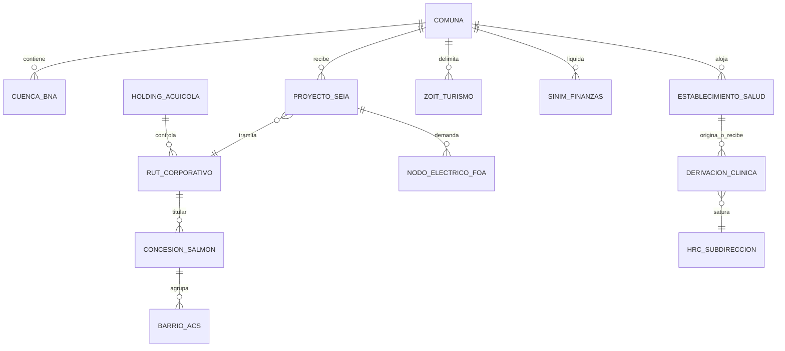

# Diálogo de Profundización: 10 Preguntas sobre Sistemas Complejos Dinámicos, Cibernética Organizacional y Prospectiva Territorial para Aysén

> **Origen y Metodología:** Investigación dialógica exhaustiva realizada contra el cuaderno de NotebookLM *"Evaluating Complex Interventions: Challenges and Approaches"* (ID: `81d2e6c4-8204-4401-ba86-e4689db32097`), compuesto por 34 fuentes científicas y documentales de frontera (Michael C. Jackson, Stafford Beer, Werner Ulrich, Pete Barbrook-Johnson & Alexandra Penn, Danny Burns, Ann Larson, Ray Pawson & Nick Tilley, Descentralización en Chile 1990-2025, y Gestión Clínica/Humanización del Hospital Regional de Coyhaique).
> 
> **Fecha:** Octubre 2026 | **Conversación ID en NotebookLM:** `c00ad078-b464-4214-9806-ad51c61e1420` | **Estado:** 10/10 Preguntas y Respuestas Completadas e Integradas.

## Tabla de Contenidos

- [Pregunta 1: Fundamentos de Sistemas Complejos Dinámicos vs. Capas Aisladas](#pregunta-1)
- [Pregunta 2: Diagramas de Bucle Causal (CLD) y Mapeo Participativo (Barbrook-Johnson & Penn / PSMtoToC)](#pregunta-2)
- [Pregunta 3: Modelo del Sistema Viable (VSM de Beer / Jackson) y Descentralización en Chile](#pregunta-3)
- [Pregunta 4: Complejidad Coercitiva, Asimetría de Poder y Heurística Crítica de Sistemas (CSH de Ulrich)](#pregunta-4)
- [Pregunta 5: Ruptura del Triángulo de Hierro y Evaluación Realista CMO (Pawson & Tilley)](#pregunta-5)
- [Pregunta 6: Atractores Dominantes, Efecto Elástico y Palancas al 2030-2035 (Danny Burns / SAR)](#pregunta-6)
- [Pregunta 7: El Hospital Regional de Coyhaique (HRC) y la Red de Salud como Sensor Sistémico](#pregunta-7)
- [Pregunta 8: De un 'Mapa que Estorba' a un Escritorio de Modelamiento Sistémico y Relacional](#pregunta-8)
- [Pregunta 9: Las 8 Preguntas de Evaluación en Complejidad y Superforecasting 2030-2035 (Larson)](#pregunta-9)
- [Pregunta 10: Plano Maestro y Síntesis Arquitectónica para Reconstruir la Plataforma de Aysén](#pregunta-10)
- [Síntesis Ejecutiva de Hallazgos y Hoja de Ruta de Reconstrucción](#sintesis-ejecutiva-de-hallazgos-y-hoja-de-ruta-de-reconstruccion)
  - [1. El Diagnóstico Crítico: La Ceguera del Mapa Geográfico Tradicional](#1-el-diagnostico-critico-la-ceguera-del-mapa-geografico-tradicional)
  - [2. Las 5 Vistas del Nuevo Escritorio Sistémico](#2-las-5-vistas-del-nuevo-escritorio-sistemico)
  - [3. Malla Relacional Unificada de las 6 Bases de Datos](#3-malla-relacional-unificada-de-las-6-bases-de-datos)
  - [4. El Motor Causal, Evaluativo y Dinámico](#4-el-motor-causal-evaluativo-y-dinamico)
  - [5. El Manifiesto Anti-Slop: Las 6 Prohibiciones Innegociables](#5-el-manifiesto-anti-slop-las-6-prohibiciones-innegociables)
  - [6. Hoja de Ruta para el Rediseño de la Plataforma de Aysén](#6-hoja-de-ruta-para-el-rediseno-de-la-plataforma-de-aysen)

---

## Pregunta 1: Fundamentos de Sistemas Complejos Dinámicos vs. Capas Aisladas {#pregunta-1}

### Pregunta Formulada al Cuaderno

```text
Hola. Estamos construyendo una plataforma de inteligencia territorial y prospectiva (2030-2035) para la Región de Aysén (sus 10 comunas, integrando finanzas municipales SINIM, 745 concesiones salmoneras agrupadas en 12 holdings y 42 RUTs, proyectos de inversión SEIA, energía aislada, telecomunicaciones FOA, turismo SERNATUR/ZOIT y red de salud/Hospital Regional de Coyhaique). Hasta ahora cometimos el error clásico de tratar el territorio como una colección de capas aisladas en un mapa o tablas estáticas. Desde la perspectiva de los textos de tu cuaderno (como Hawe et al. sobre intervenciones en sistemas complejos, Michael C. Jackson sobre Critical Systems Thinking y los documentos sobre descentralización y salud en Coyhaique/Chile), ¿cuál es la diferencia fundamental entre visualizar "indicadores aislados de un territorio" versus modelar Aysén como un "sistema complejo dinámico", y qué propiedades emergentes, bucles de retroalimentación o dependencias de trayectoria (path dependence) deberíamos hacer visibles en nuestra plataforma?
```

### Respuesta Íntegra de NotebookLM

La **diferencia fundamental** entre visualizar indicadores aislados y modelar a la Región de Aysén como un **sistema complejo dinámico** radica en la epistemología sobre cómo se comprende e interviene el territorio: pasar de la superposición de capas estáticas e independientes a la comprensión de un **sistema adaptativo complejo** abierto, vivo y no lineal [1-3].

### 1. Indicadores aislados vs. Sistema complejo dinámico

* **Visualización tradicional (Capas e indicadores aislados):** Asume que el territorio se puede descomponer en variables lineales e independientes (capas GIS de concesiones salmoneras, tablas presupuestarias SINIM, proyectos SEIA, camas del Hospital Regional de Coyhaique) [1, 4]. Bajo este enfoque, las decisiones se planifican con una lógica "complicada" o determinista (donde una inversión \\(X\\) produce proporcionalmente un resultado \\(Y\\)), congelando las interrelaciones en el tiempo y tratando al entorno como un telón de fondo estático [4-8].
* **Modelamiento como Sistema Complejo Dinámico (Hawe et al., Jackson):** Reconoce que Aysén es un **sistema adaptativo complejo** [3, 9]. Como plantean Hawe et al. y Moore et al., las intervenciones (sea la fibra óptica FOA, una nueva regulación a los holdings salmoneros o una reforma en la red de salud) no son componentes fijos descontextualizados, sino **"eventos dentro de un sistema"** que alteran las dinámicas preexistentes, desencadenan interacciones no lineales y provocan procesos de autoorganización [10-13]. Desde el **Critical Systems Thinking (CST)** de Michael C. Jackson, un territorio entrelaza complejidad técnica (redes físicas), estructural (dinámica de flujos), humana (pluralidad de visiones de los actores) y de gobernanza o poder [14-18].

---

### 2. Propiedades clave a hacer visibles en la plataforma (2030-2035)

Para que la plataforma sea verdaderamente prospectiva y no solo un mapa descriptivo, debe visibilizar tres propiedades sistémicas esenciales:

#### A. Dependencia de trayectoria (*Path Dependence*)
* **Concepto:** Las decisiones, infraestructuras y normas históricas construyen "atractores" e inercias que delimitan y condicionan la gama de opciones de desarrollo futuro [19-21].
* **Visibilidad en Aysén:** La plataforma debe evidenciar cómo la geografía insular y la rigidez de los sistemas energéticos aislados, sumadas al rol del **Hospital Regional de Coyhaique (HRC)** como único nodo de alta complejidad en toda la región [22-24], generan cuellos de botella estructurados. Del mismo modo, la concentración económica en 12 holdings salmoneros (42 RUTs) y la dependencia de los presupuestos municipales del SINIM generan rigideces históricas que restringen la capacidad de respuesta local ante shocks externos [3, 20].

#### B. Bucles de retroalimentación (*Feedback Loops*)
Las relaciones causa-efecto en sistemas complejos son cíclicas y no proporcionales [25-27]:

1. **Bucles de Refuerzo o Positivos (*Reinforcing Loops*):**
   * *Ecosistema Productivo-Infraestructura:* El crecimiento de proyectos salmoneros/SEIA impulsa la atracción poblacional y la demanda de conectividad digital (FOA) y energía [6, 26]. Esto incrementa la actividad económica, pero simultáneamente sobrecarga los servicios municipales (SINIM) y presiona la urgencia y listas de espera del HRC, lo que a su vez impacta sobre el entorno ambiental necesario para el turismo sustentable (SERNATUR/ZOIT) [6, 26, 28].
2. **Bucles de Equilibrio u Homeostáticos (*Balancing Loops*):**
   * *Red Asistencial e Interconexión APS-HRC:* El proceso de **referencia y contrarreferencia** entre la Atención Primaria de Salud (APS municipal) y el HRC actúa como un circuito regulador [22, 26, 29]. Si la APS no logra resolver problemas por brechas presupuestarias (SINIM), se dispara la tasa de derivación al especialista en Coyhaique, saturando el hospital regional [22, 29, 30]. Esto desencadena respuestas paliativas (como rondas médicas de especialistas a comunas alejadas o traslados de urgencia SAMU) para intentar estabilizar la red [29, 31, 32].

#### C. Propiedades emergentes (*Emergence*)
* **Concepto:** Patrones y comportamientos globales del territorio que nacen de las interacciones locales de múltiples agentes y que no pueden predecirse analizando las partes por separado [33-35].
* **Visibilidad en Aysén:** La **resiliencia territorial**, la retención de profesionales de la salud en zonas geográficamente aisladas, la cohesión comunitaria o la vulnerabilidad socioambiental no son datos fijos [35, 36]. Emergen de la forma en que interactúan las decisiones de inversión de los 42 RUTs salmoneros, la gestión del Servicio de Salud Aysén (SSA), los incentivos municipales y las dinámicas socioecológicas de las 10 comunas [3, 35, 36].

---

### 3. Recomendaciones de arquitectura sistémica para la plataforma

Para traducir este marco conceptual en herramientas concretas:

1. **Modelamiento mediante Diagramas de Bucle Causal (CLD) y Dinámica de Sistemas:** Reemplazar las tablas estáticas por modelos causales dinámicos (Barbrook-Johnson & Penn) que permitan simular escenarios "qué pasaría si" (*what-if*) al 2030-2035 ante variaciones en inversión, regulación o subsidios [16, 37-39].
2. **Niveles de Recursión (Modelo del Sistema Viable - VSM):** Aplicar la lógica de Stafford Beer y Jackson sobre sistemas anidados [40-42]. La plataforma debe estructurar tres niveles de recursión: *Comuna (nivel local/operativo) \\(\rightarrow\\) Provincia/Red Asistencial \\(\rightarrow\\) Región de Aysén*, garantizando la autonomía operativa de cada una de las 10 comunas mientras se coordina la cohesión regional [41-43].
3. **Mapeo de Perspectivas y Juicios de Frontera (*Critical Systems Heuristics* - CSH):** Incorporar la perspectiva pluralista de Ulrich y Jackson para hacer explícitos los juicios de frontera (qué datos, intereses y valores se están incluyendo o excluyendo en las decisiones de la plataforma) y facilitar el diálogo entre los holdings salmoneros, los municipios, el sector salud y las comunidades locales [15, 18, 44].

💡 *¿Te gustaría que profundicemos en cómo estructurar un diagrama de bucle causal específico que conecte el financiamiento municipal SINIM, las concesiones salmoneras y la demanda sobre el Hospital Regional de Coyhaique?*

> *Fuentes utilizadas por el cuaderno en esta respuesta: 16 fuentes citadas.*

---

## Pregunta 2: Diagramas de Bucle Causal (CLD) y Mapeo Participativo (Barbrook-Johnson & Penn / PSMtoToC) {#pregunta-2}

### Pregunta Formulada al Cuaderno

```text
Tomando como referencia los marcos de Diagramas de Bucle Causal (CLD), Mapeo Participativo de Sistemas (Participatory Systems Mapping - Barbrook-Johnson & Penn 2021) y la transición de PSM a Teoría de Cambio (PSM to ToC) presentes en tu cuaderno, ¿cómo estructurar concretamente los bucles de refuerzo (R) y de equilibrio (B), incluyendo sus demoras temporales críticas (lags), que conectan en Aysén las siguientes dinámicas territoriales:
1. El financiamiento municipal (dependencia extrema del Fondo Común Municipal / SINIM en comunas aisladas como Tortel o Guaitecas vs Coyhaique).
2. La concentración industrial de las 745 concesiones salmoneras en 12 holdings (42 RUTs) y los flujos de inversión evaluados en el SEIA.
3. La estacionalidad turística estival (SERNATUR / ZOIT) y la presión sobre servicios básicos.
4. La demanda asistencial sobre la Atención Primaria de Salud (APS) municipal y el cuello de botella en el Hospital Regional de Coyhaique (HRC)?
Por favor detalla las variables clave (en formato de sustantivos), las polaridades de enlace (S/+, O/-), la identificación de bucles R y B específicos, y dónde se sitúan las principales demoras temporales que desestabilizan las políticas públicas en el territorio.
```

### Respuesta Íntegra de NotebookLM

Para estructurar de forma rigurosa la interconexión sistémica entre las cuatro dinámicas territoriales de Aysén, integramos las reglas de los **Diagramas de Bucle Causal (CLD)**, la metodología del **Mapeo Participativo de Sistemas (PSM)** de Barbrook-Johnson & Penn [1, 2] y el proceso de **transición de PSM a Teoría de Cambio (PSM to ToC)** según Wilkinson et al. [3].

---

### 1. Reglas Metodológicas de Sintaxis e Integración

* **Variables (Nodos)**: Se formulan estrictamente en **formato de sustantivo o frase nominal** que represente cantidades o niveles susceptibles de aumentar o disminuir [1, 4, 5].
* **Polaridades de Enlace**:
  * **Mismo sentido (\\(S\\) o \\(+\\))**: Un incremento/decrecimiento en la variable de origen produce un cambio en la **misma dirección** en la variable de destino [1, 4, 6].
  * **Sentido opuesto (\\(O\\) o \\(-\\))**: Un incremento en la variable de origen produce un cambio en **dirección opuesta** en la variable de destino [1, 4, 6].
* **Bucles de Realimentación**:
  * **Refuerzo (\\(R\\))**: Circuitos de realimentación positiva que amplifican los cambios en el tiempo [1, 4, 7].
  * **Equilibrio (\\(B\\))**: Circuitos de realimentación negativa que imponen autorregulación o límites [1, 4, 7].
* **Demoras Temporales (\\(//\\) / Lags)**: Indican descalces o desfases de tiempo entre la causa y el efecto que desestabilizan las políticas públicas [8-10].
* **Tránsito PSM \\(\rightarrow\\) ToC**: Organiza los factores del mapa sistémico en una secuencia lógica de intervención, explicitando supuestos, retrasos y efectos no deseados [3, 11, 12].

---

### 2. Inventario Formal de Variables Clave (Sustantivos)

* **Dimensión Fiscal Municipal**:
  * `Dependencia del Fondo Común Municipal (FCM / SINIM)`
  * `Recaudación por Patentes Municipales y Patentes Acuícolas`
  * `Gasto Operativo Comunal en Infraestructura y Servicios Básicos`
  * `Aislamiento y Dispersión Geográfica Comunal`
* **Dimensión Acuícola e Inversión Industrial**:
  * `Concentración Industrial Salmonera (Holdings / Concesiones)`
  * `Flujos de Inversión Evaluados en el SEIA`
  * `Carga Logística y Demanda Ambiental Local`
  * `Centralización Fiscal de Matricez Corporativas`
* **Dimensión Turística Estival**:
  * `Declaración de Zonas de Interés Turístico (ZOIT) / Promoción SERNATUR`
  * `Afluencia de Población Flotante Estival`
  * `Presión sobre Capacidad de Servicios e Insumos Locales`
* **Dimensión Sanitaria y Hospitalaria**:
  * `Demanda Asistencial sobre la APS Municipal`
  * `Capacidad Resolutiva de la APS Rural/Municipal`
  * `Tasa de Derivación a Nivel Terciario`
  * `Saturación del Hospital Regional de Coyhaique (HRC)`
  * `Frecuencia de Evacuaciones Aeromédicas Extrarestringidas`
  * `Disponibilidad de Médicos Especialistas en la Red`

---

### 3. Identificación y Estructura Concreta de Bucles Causales (\\(R\\) y \\(B\\))

#### **Bucle R1: Bucle de Concentración Industrial y Trampa Fiscal Comunal (Refuerzo)**
* **Mapeo del bucle**:
  * `Concentración Industrial Salmonera` \\(\xrightarrow{S/+}\\) `Flujos de Inversión Evaluados en el SEIA`
  * `Flujos de Inversión Evaluados en el SEIA` \\(\xrightarrow{S/+}\\) `Carga Logística y Demanda Ambiental Local` (en comunas aisladas como Tortel o Guaitecas)
  * `Carga Logística y Demanda Ambiental Local` \\(\xrightarrow{S/+}\\) `Gasto Operativo Comunal en Infraestructura y Servicios Básicos`
  * `Gasto Operativo Comunal` \\(\xrightarrow{O/-}\\) `Sostenibilidad Presupuestaria Municipal Local`
  * `Sostenibilidad Presupuestaria Municipal Local` \\(\xrightarrow{O/-}\\) `Dependencia del Fondo Común Municipal (FCM / SINIM)` [13, 14]
* **Lógica del bucle**: Al estar la propiedad de las 745 concesiones concentrada en 12 holdings (42 RUTs), la mayor parte de la tributación corporal y patentes se centraliza en casas matrices o en la cabecera regional [14]. Las comunas aisladas soportan el impacto operativo sin captar ingresos proporcionales, profundizando la trampa de dependencia del FCM/SINIM [13, 14].

#### **Bucle R2: Bucle de Flujo Turístico Estival y Desbordamiento Operativo Municipal (Refuerzo / Límite al Desarrollo)**
* **Mapeo del bucle**:
  * `Declaración ZOIT / Promoción SERNATUR` \\(\xrightarrow{S/+}\\) `Afluencia de Población Flotante Estival`
  * `Afluencia de Población Flotante Estival` \\(\xrightarrow{S/+}\\) `Presión sobre Capacidad de Servicios e Insumos Locales`
  * `Presión sobre Capacidad de Servicios e Insumos Locales` \\(\xrightarrow{S/+}\\) `Demanda Asistencial sobre la APS Municipal` [15]
  * `Demanda Asistencial sobre la APS Municipal` \\(\xrightarrow{O/-}\\) `Capacidad Resolutiva de la APS Rural/Municipal`
  * `Capacidad Resolutiva de la APS Rural/Municipal` \\(\xrightarrow{O/-}\\) `Sostenibilidad Presupuestaria Municipal Local`
  * `Sostenibilidad Presupuestaria Municipal Local` \\(\xrightarrow{S/+}\\) `Dependencia del Fondo Común Municipal (FCM / SINIM)` [14, 16]
* **Lógica del bucle**: El turismo estival genera picos intensos de demanda en comunas con infraestructura base acotada, sobrecargando las postas y consultorios rurales cuyo financiamiento per cápita no contempla la población flotante [15, 16].

#### **Bucle B1: Bucle de Cuello de Botella Asistencial en el HRC (Equilibrio / Saturación)**
* **Mapeo del bucle**:
  * `Demanda Asistencial sobre la APS Municipal` \\(\xrightarrow{O/-}\\) `Capacidad Resolutiva de la APS Rural/Municipal`
  * `Capacidad Resolutiva de la APS Rural/Municipal` \\(\xrightarrow{O/-}\\) `Tasa de Derivación a Nivel Terciario` [15, 17, 18]
  * `Tasa de Derivación a Nivel Terciario` \\(\xrightarrow{S/+}\\) `Saturación del Hospital Regional de Coyhaique (HRC)` [18-20]
  * `Saturación del Hospital Regional de Coyhaique (HRC)` \\(\xrightarrow{S/+}\\) `Frecuencia de Evacuaciones Aeromédicas Extrarestringidas` [21]
  * `Frecuencia de Evacuaciones Aeromédicas Extrarestringidas` \\(\xrightarrow{S/+}\\) `Costo Operativo del Servicio de Salud Aysén` [21, 22]
  * `Costo Operativo del Servicio de Salud Aysén` \\(\xrightarrow{O/-}\\) `Presupuesto Disponible para Inversión en Red Asistencial` [23, 24]
  * `Presupuesto Disponible para Inversión en Red Asistencial` \\(\xrightarrow{S/+}\\) `Capacidad Resolutiva de la APS Rural/Municipal`
* **Lógica del bucle**: La falta de resolución en la APS rural incrementa la presión sobre el HRC (único establecimiento de alta complejidad en Aysén) [18, 25]. El HRC reacciona derivando hacia evacuaciones aeromédicas a otras regiones [21], consumiendo presupuesto que de otro modo podría invertirse en fortalecer la red asistencial local [23, 24].

#### **Bucle R3: Trampa de Desplazamiento de Carga (*Shifting the Burden*)**
* **Mapeo del bucle**:
  * `Déficit Resolutivo en APS Comunal Aislada` \\(\xrightarrow{S/+}\\) `Alineación Hacia Soluciones de Emergencia (Evacuaciones y Derivación al HRC)` [18, 21]
  * `Alineación Hacia Soluciones de Emergencia` \\(\xrightarrow{S/+}\\) `Asignación de Recursos de Urgencia al HRC` [26, 27]
  * `Asignación de Recursos de Urgencia al HRC` \\(\xrightarrow{O/-}\\) `Inversión Estructural en APS Comunal Aislada`
  * `Inversión Estructural en APS Comunal Aislada` \\(\xrightarrow{O/-}\\) `Déficit Resolutivo en APS Comunal Aislada` (con importante demora temporal \\(//\\))
* **Lógica del arquetipo**: La respuesta inmediata ante emergencias de salud en zonas aisladas alivia el síntoma mediante evacuaciones hacia el HRC, pero posterga la solución fundamental (desarrollo estructural y dotación de la APS en Tortel o Guaitecas) [10].

---

### 4. Localización de Demoras Temporales Críticas (\\(//\\) / Lags)

1. **Lag \\(//_1\\): Retardo en la Redistribución Fiscal Acuícola (\\(SEIA \xrightarrow{//_1} FCM / SINIM\\))**
   * *Ubicación*: Entre la aprobación/operación de proyectos en el SEIA y el reajuste efectivo de transferencias municipales [13, 14].
   * *Efecto*: Existe un desfase de 1 a 3 años entre el impacto territorial acuícola y la percepción de ingresos municipales indirectos, dejando a comunas como Tortel o Guaitecas desprotegidas financieramente para absorber el impacto operativo inicial [13, 14].
2. **Lag \\(//_2\\): Desfase del Financiamiento Per Cápita de la APS (\\(Población\ Flotante \xrightarrow{//_2} Reajuste\ Per\ Cápita\\))**
   * *Ubicación*: Entre el pico de afluencia turística estival y la actualización de los fondos per cápita transferidos por el MINSAL [15, 16].
   * *Efecto*: El financiamiento de la APS se basa en registros anuales de población residente [15, 16]. El consumo estival de insumos genera un descalce financiero inmediato que solo se regulariza en ciclos presupuestarios posteriores.
3. **Lag \\(//_3\\): Tiempos de Maduración en Infraestructura y Especialistas (\\(Saturación\ HRC \xrightarrow{//_3} Capacidad\ Resolutiva\\))**
   * *Ubicación*: Entre la saturación por listas de espera/urgencias en el HRC y la entrada en operación de nuevos proyectos de inversión o la llegada efectiva de especialistas [28-30].
   * *Efecto*: La brecha para atraer/retener médicos especialistas o concretar proyectos de infraestructura toma entre 3 y 8 años (ej. concursos de Alta Dirección Pública, habilitación de Unidades de Paciente Crítico) [28-30], tiempo durante el cual el sistema depende de soluciones sintomáticas extremas como evacuaciones aeromédicas [21].
4. **Lag \\(//_4\\): Desfase en el Proceso de Referencia y Contrarreferencia Geográfica**
   * *Ubicación*: Entre la derivación médica inicial desde comunas insulares y el retorno con tratamiento/seguimiento en la APS de origen [17, 18].
   * *Efecto*: Las barreras de conectividad geográfica dilatan el retorno de los pacientes, prolongando las estancias hospitalarias en Coyhaique y desconectando el cuidado continuo familiar [17, 18, 31].

---

### 5. Tránsito de PSM a Teoría de Cambio (PSM to ToC) para Políticas Públicas

Al reconfigurar este mapa en una **Teoría de Cambio basada en sistemas** (según el enfoque de Wilkinson et al.) [3], se identifican los siguientes **puntos de apalancamiento (*Leverage Points*)**:

1. **Reforma Fiscal Territorializada (Interrupción del Bucle R1)**: Establecer una regla de asignación directa de patentes acuícolas e impuestos corporativos para que queden retenidos en la comuna donde se emplazan las concesiones [14], reduciendo la dependencia extrema del FCM en comunas aisladas.
2. **Fondo de Compensación Sanitaria Estival (Interrupción del Bucle R2)**: Crear una asignación presupuestaria contingente para la APS municipal coordinada entre SERNATUR y el Servicio de Salud Aysén para financiar insumos y refuerzos médicos durante la temporada alta ZOIT.
3. **Red de Telemedicina y Resolutividad Distribuida (Interrupción del Bucle B1 y Arquetipo R3)**: Fortalecer la capacidad diagnóstica y resolutiva en la APS rural de Tortel y Guaitecas mediante la conexión digital con especialistas del HRC [32], disminuyendo las derivaciones innecesarias y aliviando el cuello de botella en Coyhaique [17, 18].

¿Te gustaría que elaboremos una propuesta estructurada de informe o presentación ejecutiva para profundizar en alguna de estas intervenciones de política pública?

> *Fuentes utilizadas por el cuaderno en esta respuesta: 8 fuentes citadas.*

---

## Pregunta 3: Modelo del Sistema Viable (VSM de Beer / Jackson) y Descentralización en Chile {#pregunta-3}

### Pregunta Formulada al Cuaderno

```text
Profundizando en el Modelo del Sistema Viable (VSM) de Stafford Beer / Jackson y el análisis histórico-institucional de 'Descentralización en Chile (1990-2025)' de tu cuaderno:
¿Cómo diagnosticar formalmente la viabilidad de Aysén a través de sus 5 subsistemas cibernéticos:
- S1 (Operación elemental en cada una de las 10 comunas: gestión municipal, postas rurales, servicios básicos, fomento productivo).
- S2 (Coordinación y amortiguación de oscilaciones interinstitucionales: SLEP en educación, Servicio de Salud Aysén SSA en salud, comités ZOIT/SERNATUR en turismo, Agrupaciones de Concesiones de Salmónidos ACS/Barrios).
- S3 / S3* (Control operativo, auditoría y sinergia presupuestaria: FNDR, SUBDERE, auditorías SINIM/CGR).
- S4 (Inteligencia, adaptación y prospectiva 2030-2035: monitoreo del entorno externo, cambio climático, shock de mercados acuícolas, transición energética y telecomunicaciones FOA).
- S5 (Política, identidad regional, clausura normativa y ethos territorial: Gobierno Regional GORE, Consejo Regional CORE y ciudadanía)?

¿Cuáles son las patologías organizacionales específicas (desconexión S3-S4, colapso de S2, atrofia de S4, burocratización centralista de S3 desde Santiago) y las fallas de ingeniería de variedad que impiden que comunas extremas y aisladas como Guaitecas, Tortel u O'Higgins mantengan su propia viabilidad y resuelvan problemas locales sin quedar paralizadas por el centralismo regional (Coyhaique) y nacional (Santiago)?
```

### Respuesta Íntegra de NotebookLM

Para diagnosticar formalmente la viabilidad territorial de la Región de Aysén utilizando el **Modelo del Sistema Viable (VSM)** de Stafford Beer, analizado por Michael C. Jackson [1, 2], es fundamental aplicar el **principio de recursividad**: todo sistema viable se compone de subsistemas viables anidados [3, 4]. 

En esta arquitectura, la Región de Aysén opera como el *Sistema en Foco* (Nivel de Recursión N+1), el cual contiene a las 10 comunas ayseninas como sus subsistemas operacionales (Nivel N), mientras se encuentra anidada dentro del Estado unitario chileno (Nivel N+2) [2, 5, 6].

---

### 1. Diagnóstico Formal de Aysén a través de los 5 Subsistemas Cibernéticos

* **Sistema 1 (S1 - Operación Elemental / Implementación):** 
  Representa las actividades primarias que entregan valor directo y garantizan la supervivencia cotidiana en el territorio [7, 8]. En las 10 comunas de Aysén, el S1 abarca la gestión municipal directa, la red de atención primaria de salud (postas rurales y CESFAM) [9, 10], los servicios básicos locales y las actividades productivas (pesca artesanal, ganadería, turismo comunal) [7, 11]. Para ser viable, cada S1 comunal debe poseer suficiente autonomía y su propia gestión localizada para resolver las demandas de su entorno inmediato [8, 12].
* **Sistema 2 (S2 - Coordinación y Amortiguación de Oscilaciones):** 
  Su función cibernética es armonizar las interacciones entre las distintas unidades S1 para evitar interferencias mutuas y fricciones destructivas [7, 8, 13]. En Aysén, el S2 se expresa en instancias de articulación como los **Servicios Locales de Educación Pública (SLEP)**, la coordinación de la red asistencial por parte del **Servicio de Salud Aysén (SSA)** [14, 15], los comités de **Zonas de Interés Turístico (ZOIT/SERNATUR)** [11] y las **Agrupaciones de Concesiones de Salmónidos (ACS/Barrios)**. El S2 no ejerce autoridad de mando, sino que establece protocolos, calendarios y flujos armónicos (como los sistemas de referencia/contrarreferencia en salud) para estabilizar el sistema [13, 16].
* **Sistema 3 / 3\* (S3 / S3\* - Control Operativo, Auditoría y Sinergia):** 
  * **S3 (Control Operativo):** Dirige la asignación interna de recursos operacionales, gestiona sinergias y busca optimizar el rendimiento del conjunto [7, 17]. Se encarna en las divisiones del **Gobierno Regional (GORE)**, la **SUBDERE** [11, 18], la administración del **Fondo Nacional de Desarrollo Regional (FNDR)** [19, 20] y la gestión presupuestaria del SSA y los ministerios [21, 22].
  * **S3\* (Auditoría y Canal de Monitoreo Directo):** Realiza verificaciones esporádicas y directas en el entorno operativo para auditar el cumplimiento sin saturar los canales de reportabilidad cotidiana [17, 23]. Incluye las auditorías de la **Contraloría General de la República (CGR)**, los controles del **SINIM**, las fiscalizaciones de la **SEREMI de Salud** [24] y las evaluaciones de la **Superintendencia de Salud** [25, 26].
* **Sistema 4 (S4 - Inteligencia, Adaptación y Prospectiva 2030-2035):** 
  Es el órgano de exploración externa enfocado en el aprendizaje y la adaptación estratégica de largo plazo ("¿en qué entorno operaremos mañana?") [17, 27, 28]. En Aysén, S4 abarca los centros de monitoreo ambiental y climático, los análisis de impacto frente a shocks en mercados acuícolas, los planes de transición energética regional y los proyectos de infraestructura de conectividad como la **Fibra Óptica Austral (FOA)** [11, 17]. Su rol es captar la variedad del entorno macro y dialogar continuamente con S3 para preparar al territorio ante cambios estructurales [17, 29].
* **Sistema 5 (S5 - Política, Identidad Regional y Ethos Territorial):** 
  Define la clausura normativa, la visión de conjunto y la identidad del sistema, representando las políticas generales y el marco ético territorial [27, 30]. En Aysén, S5 está constituido por el **Gobernador Regional electo**, el **Consejo Regional (CORE)**, las instancias de participación ciudadana y la preservación de la identidad patagónica [11, 31, 32]. La tarea cibernética central de S5 es arbitrar y equilibrar la tensión permanente entre el deseo de estabilidad operativa de S3 y la exigencia de cambio y adaptación de S4 [27, 29].

---

### 2. Patologías Organizacionales y Fallas de Ingeniería de Variedad en Comunas Extremas (Guaitecas, Tortel, O'Higgins)

El aislamiento geográfico e insular de comunas como Guaitecas, Tortel u O'Higgins devela severas disfunciones estructurales cuando se analiza la gobernanza regional y nacional desde la cibernética organizacional:

#### A. Autopoiesis Patológica y Burocratización Centralista de S3
Ocurre una **autopoiesis patológica** cuando los subsistemas de gestión y soporte (S2, S3, S4) dejan de servir a las operaciones primarias (S1) y comienzan a actuar para preservar su propia burocracia, normas e intereses corporativos [3, 33, 34]. 
* **Desde Santiago y Coyhaique:** El S3 central/regional opera bajo una lógica de estandarización rígida (glosas presupuestarias del FNDR/SUBDERE, controles de rendición en el SINIM y CGR) [20, 35, 36]. En lugar de otorgar flexibilidad operacional a las comunas extremas, S3 impone sobre exigencias administrativas homogéneas [10, 37]. Esto provoca que las unidades operacionales comunales gasten más energía cumpliendo trámites burocráticos que resolviendo emergencias locales de conectividad o salud rural [33, 37].

#### B. Desconexión S3-S4 ("Esquizofrenia Organizacional") y Atrofia de S4
* **Atrofia de S4:** En la escala comunal y regional, el Sistema 4 carece de capacidad prospectiva real [38]. Las unidades técnicas (como las SECPLAC municipales o divisiones del GORE) están completamente absorbidas en la formulación rápida de proyectos para competir por fondos, perdiendo la capacidad de monitorear riesgos sistémicos (eventos climáticos extremos, fallas de transporte marítimo/aéreo, vulnerabilidad energética) [10, 37].
* **Desconexión S3-S4:** Sin un diálogo dinámico entre el control operacional (S3) y la inteligencia prospectiva (S4) [27, 29], la toma de decisiones en Coyhaique y Santiago cae en una gestión reactiva ("apagar incendios") [17, 39]. Se abordan las crisis cuando ya han colapsado los servicios en las comunas aisladas, en lugar de adaptar la infraestructura y las normativas anticipadamente [17, 39].

#### C. Colapso y Debilidad del Sistema 2 (S2)
La falta de mecanismos cibernéticos de coordinación en el territorio provoca que los sectores primarios (S1) colisionen constantemente [23, 38]. En Guaitecas o Tortel, las actividades pesqueras/acuícolas (ACS/Barrios), la conservación en áreas protegidas, las Zonas de Interés Turístico (ZOIT) [11] y la conectividad pública operan como "silos" desarticulados [22]. La ausencia de un S2 territorial fluido genera conflictos no resueltos y judicialización, frenando el desarrollo local [10, 13].

#### D. Fallas en la Ingeniería de Variedad (Ley de Requisite Variety de Ashby)
* **La Ley de Ashby:** *"Solo la variedad puede absorber variedad"* [12]. El entorno geográfico de las comunas extremas presenta una **variedad ambiental masiva e impredecible** (inclemencias climáticas, desconexión marítima, emergencias de salud sin especialistas) [39, 40].
* **Falla de Requisito de Variedad:** Para que los S1 comunales (municipios, postas rurales) mantengan su viabilidad, la Ley de Ashby exige otorgarles **alta autonomía operacional** e instrumentos de respuesta local inmediata [12, 41]. Sin embargo, el centralismo estatal aplica una **atenuación coercitiva e ineficiente de la variedad local**: impone marcos normativos inflexibles redactados en el centro [35, 42] y restringe la capacidad de decisión de los actores locales [20, 37].
* **Parálisis por Doble Centralismo:** Las comunas extremas sufren una doble subordinación jerárquica: ante Coyhaique (centro regional) y ante Santiago (centro nacional) [6, 43]. Al no contar con autonomía presupuestaria ni facultades resolutivas en el nivel local [20, 37], cualquier contingencia en Guaitecas, Tortel u O'Higgins requiere largas cadenas de autorización entre el Delegado Presidencial, el GORE, las SEREMIs y los ministerios [22, 44]. Esto produce la parálisis de la viabilidad comunal, dejando a las poblaciones aisladas en una condición de extrema vulnerabilidad operacional [39, 43].

---

💡 **¿Te gustaría que elaboremos un mapa de diseño organizacional bajo el VSM para reestructurar la autonomía y las delegaciones de variedad específicamente entre el Gobierno Regional de Aysén y los municipios de comunas extremas?**

> *Fuentes utilizadas por el cuaderno en esta respuesta: 5 fuentes citadas.*

---

## Pregunta 4: Complejidad Coercitiva, Asimetría de Poder y Heurística Crítica de Sistemas (CSH de Ulrich) {#pregunta-4}

### Pregunta Formulada al Cuaderno

```text
En nuestros datos territoriales descubrimos una brutal asimetría de poder estructural: 12 holdings empresariales controlan el 97,4% de las 745 concesiones salmoneras de Aysén operando mediante 42 razones sociales (RUTs) distintas, mientras comunas aisladas como Tortel o Guaitecas dependen en más del 80% del Fondo Común Municipal (FCM / SINIM) y carecen de autonomía fiscal.

Basándote en el Critical Systems Thinking de Michael C. Jackson —específicamente el cuadrante Complejo-Coercitivo (Complex-Coercive) del SOSM (System of Systems Methodologies)— y en la Heurística Crítica de Sistemas (Critical Systems Heuristics - CSH) de Werner Ulrich:
1. ¿Por qué las metodologías duras (modelos econométricos/GIS lineales) y las metodologías blandas de consenso (SSM / talleres participativos ingenuos) fracasan ante este tipo de contextos coercitivos donde hay conflicto irreconciliable de intereses?
2. ¿Cómo adaptar las 12 preguntas de 'Juicios de Frontera' de Ulrich (divididas en las cuatro fuentes de influencia: Motivación/Propósito, Control/Poder, Conocimiento/Experiencia, y Legitimidad/Testigos de los afectados) para auditar la asignación de recursos y concesiones en Aysén? (Detalla el contraste sistemático entre 'es' / is vs 'debería ser' / ought to be).
3. ¿Qué visualizaciones e instrumentos concretos (redes de propiedad y RUTs vs municipios, mapas de distribución de externalidades vs rentas tributarias retenidas localmente) debería desplegar la plataforma para emancipar y nivelar la asimetría de información de los actores históricamente desaventajados en el territorio?
```

### Respuesta Íntegra de NotebookLM

El escenario territorial descrit, donde 12 holdings empresariales concentran el 97,4% de las 745 concesiones salmoneras de Aysén a través de 42 razones sociales (RUTs), mientras comunas como Tortel o Guaitecas presentan una dependencia del Fondo Común Municipal (FCM / SINIM) superior al 80%, constituye un caso manifiesto de **asimetría de poder estructural**. 

Desde la perspectiva del **Pensamiento Crítico de Sistemas (Critical Systems Thinking - CST)** de Michael C. Jackson [1, 2] y la **Heurística Crítica de Sistemas (Critical Systems Heuristics - CSH)** de Werner Ulrich [3, 4], este contexto se analiza y aborda a través de los siguientes tres puntos:

---

### 1. ¿Por qué fracasan las metodologías duras y las de consenso ante contextos coercitivos?

En el marco del **Sistema de Metodologías de Sistemas (SOSM)** desarrollado por Jackson, los contextos de intervención se clasifican según la complejidad del sistema y la relación entre los actores/participantes [5-7]. Este escenario se ubica de forma nítida en el cuadrante **Complejo-Coercitivo (Complex-Coercive)** [6, 8-10]:

*   **Fracaso de las metodologías duras (Modelos econométricos / GIS lineales)**:
    Las metodologías duras (como la ingeniería de sistemas, investigación operacional tradicional o modelación econométrica estándar) están diseñadas bajo el supuesto **Simple-Unitario** o **Complicado-Unitario** [11-13]. Presuponen que existe un único objetivo consensuado (ej. "optimizar la producción o la recaudación nacional") y que el problema es técnico [11, 14]. Ante un contexto coercitivo, fracasan porque **reducen el conflicto de poder a variables puramente numéricas u optimizaciones espaciales**, ignorando que la definición misma de los insumos del modelo y la asignación de concesiones están moldeadas por relaciones de dominación e intereses corporativos irreconciliables [14, 15].

*   **Fracaso de las metodologías blandas de consenso (SSM / Talleres participativos ingenuos)**:
    Metodologías como la *Soft Systems Methodology* (SSM) de Checkland presuponen un contexto **Pluralista** (*Simple-Pluralista* o *Complejo-Pluralista*), en el cual los actores comparten un marco ético básico y están dispuestos a dialogar en buena fe para alcanzar "acomodaciones" [6, 16-18]. En un entorno coercitivo, estas metodologías fracasan debido a tres factores estructurales:
    1.  **Comunicación distorsionada por el poder**: Presuponen de forma ingenua las condiciones de un diálogo libre de dominación [19-21].
    2.  **Operación de las tres caras del poder de Lukes**: El actor corporativo no solo ejerce poder explícito sobre las decisiones (1ª cara) [22], sino que ejerce poder de *no-decisión* (2ª cara), delimitando la agenda de los talleres para evitar debatir temas de fondo como la redistribución tributaria o la concentración de licencias, tildándolos de "fuera de alcance" [20, 22]. Asimismo, opera la cara *ideológica* (3ª cara), instalando la narrativa del desarrollo salmonero como la única vía posible para el territorio [10, 22].
    3.  **Cooptación y legitimación del statu quo**: Al buscar un "consenso superficial" en talleres participativos desequilibrados, se termina validando el marco fijado por el actor dominante, dejando intacta la dependencia fiscal de comunas como Tortel o Guaitecas [20, 21].

---

### 2. Auditoría CSH: Las 12 preguntas de 'Juicios de Frontera' adaptadas a Aysén

La **Heurística Crítica de Sistemas (CSH)** de Werner Ulrich utiliza 12 preguntas agrupadas en cuatro fuentes de influencia para revelar el contenido normativo y las selecciones implícitas en cualquier diseño de sistema [4, 23, 24]. Para auditar la asignación de recursos y concesiones salmoneras en Aysén, se contrasta sistemáticamente el plano del **"Es"** (*actual mapping* - realidad observada) frente al **"Debería ser"** (*ideal mapping* - perspectiva emancipadora y territorial) [25-29]:

#### I. Fuentes de Motivación / Propósito (*Sources of Motivation*) [23, 24, 27]
1. **Cliente / Beneficiario**:
   * *Es*: Los 12 holdings empresariales centralizados y sus accionistas privados [27].
   * *Debería ser*: Las comunidades locales de la Región de Aysén y los habitantes de comunas aisladas [27].
2. **Propósito**:
   * *Es*: Maximizar el volumen de producción y la rentabilidad privada del sector salmonero, externalizando los costos socioecológicos en los fiordos [27].
   * *Debería ser*: Garantizar el desarrollo territorial sostenible, la conservación del maritorio y la autonomía socioeconómica comunal [27].
3. **Medida de éxito / Mejora**:
   * *Es*: Cifras de toneladas cosechadas, retorno financiero corporativo y divisas de exportación centralizadas [27].
   * *Debería ser*: Retención de rentas tributarias locales, reducción de la dependencia del FCM/SINIM a niveles sostenibles y salud del ecosistema marino [27].

#### II. Fuentes de Control / Poder (*Sources of Power*) [23, 24, 28]
4. **Toma de decisiones**:
   * *Es*: Cúpulas directivas de los holdings en alianza con reguladores del nivel central (Subpesca, Sernapesca) [28].
   * *Debería ser*: Instancias de gobernanza territorial donde los Gobiernos Regionales (GORE) y los municipios de Tortel y Guaitecas posean poder resolutivo e incisivo [28, 30].
5. **Recursos bajo control**:
   * *Es*: 745 concesiones acuícolas fragmentadas en 42 RUTs corporativos para diluir la percepción de monopolio [28].
   * *Debería ser*: Fondos de patentes acuícolas y tributos territoriales de asignación y recaudación local/regional directa [28, 31].
6. **Entorno de decisión (fuera de control de los municipios)**:
   * *Es*: La fragilidad fiscal de los municipios aislados (que dependen >80% de transferencias del FCM) y el marco normativo nacional [28, 32].
   * *Debería ser*: Leyes de descentralización y rentas regionales que garanticen autonomía financiera constitucional a las comunas costeras [28, 31, 33].

#### III. Fuentes de Conocimiento / Experiencia (*Sources of Knowledge*) [23, 24, 28]
7. **Expertos / Profesionales**:
   * *Es*: Consultoras ambientales corporativas, abogados de marcas y economistas del nivel central [28].
   * *Debería ser*: Científicos independientes, geógrafos comunitarios, pescadores artesanales y conocedores del maritorio local [28].
8. **Saber / Conocimiento relevante**:
   * *Es*: Informes de biomasa y capacidad de carga industrial desarticulados por RUT [28].
   * *Debería ser*: Mapas consolidados de propiedad corporativa matriz, acumulaciones de impacto ecológico e indicadores de flujo fiscal real [28].
9. **Garante de éxito**:
   * *Es*: Cumplimiento formal de Resoluciones de Calificación Ambiental (RCA) e inspecciones estatales de alcance limitado [28].
   * *Debería ser*: Auditorías comunitarias en tiempo real, monitoreo ambiental participativo y cláusulas de revocación de concesión por concentración excesiva o daño severo [28].

#### IV. Fuentes de Legitimidad / Testigos de los Afectados (*Sources of Legitimacy*) [23, 24, 29]
10. **Testigos de los afectados**:
    * *Es*: Organizaciones territoriales de Tortel, Guaitecas, pescadores y pueblos originarios, cuyos reclamos son canalizados de manera no vinculante [29].
    * *Debería ser*: Veedurías ciudadanas constituidas con estatus legal prioritario para impugnar asignaciones desproporcionadas [29].
11. **Emancipación / Espacio de liberación**:
    * *Es*: Mitigaciones menores de responsabilidad social empresarial que mantienen la estructura de subordinación económica [29].
    * *Debería ser*: La nivelación de la asimetría informativa para que las comunidades identifiquen las redes de poder y exijan soberanía tributaria y ambiental [29].
12. **Cosmovisión / Filosofía de vida**:
    * *Es*: Visión del maritorio como una frontera extractiva y plataforma de commodities de libre mercado [29].
    * *Debería ser*: El maritorio concebido como patrimonio socio-ecológico intergeneracional, espacio de vida y sustento de la identidad local [29].

---

### 3. Visualizaciones e instrumentos concretos de la plataforma para emancipar y nivelar la asimetría informativa

Para desplegar la **crítica de fronteras emancipadora** (*emancipatory boundary critique*) [26, 34], la plataforma tecnológica debe incorporar herramientas visuales e instrumentos de auditoría ciudadana que transfieran poder interpretativo a los actores vulnerados [34-36]:

1. **Grafo de Redes de Propiedad Corporativa y Mapeo de RUTs (*Beneficial Ownership Network*)**:
   * *Instrumento*: Un visualizador interactivo de redes que consolide las 42 razones sociales (RUTs) bajo sus 12 holdings matrices finales. 
   * *Efecto emancipador*: Visibiliza la concentración real (97,4% de las 745 concesiones), desmantelando la estrategia corporativa de fragmentación jurídica utilizada para eludir límites antimonopolio y ambientales.

2. **Mapa Bivariado de Externalidades vs. Rentas Tributarias Retenidas**:
   * *Instrumento*: Un mapa GIS bivariado que contraponga en capas superpuestas la densidad de impactos ambientales (zonas anaeróbicas, uso de antibióticos, escapes de salmón) con la fuga de valor fiscal (patentes retenidas en comunas centrales vs. presupuesto municipal propio en Tortel y Guaitecas).
   * *Efecto emancipador*: Muestra gráficamente cómo la carga ambiental recae en el territorio local mientras la renta financiera se transfiere fuera de la región, reforzando la dependencia del FCM/SINIM.

3. **Matriz Interactiva de Crítica Polemíca de Fronteras (*CSH Polemical Boundary Auditor*)**:
   * *Instrumento*: Una herramienta donde alcaldes, concejales y dirigentes sociales introduzcan proyectos de expansión salmonera o evaluaciones ambientales y apliquen el contraste "Es" vs. "Debería ser".
   * *Efecto emancipador*: Aplica el "uso polémico de los juicios de frontera" descrito por Ulrich [35, 37], desplazando la carga de la prueba hacia los holdings y el Estado para obligarlos a justificar sus supuestos técnicos y selecciones de frontera [35, 36].

4. **Tablero de Soberanía Fiscal y Balanza de Valor Territorial**:
   * *Instrumento*: Una calculadora en tiempo real que cuantifique el "Déficit de Soberanía Fiscal", comparando la estimación del valor extraído del maritorio de Aysén por los holdings con los aportes efectivos del FCM/SINIM recibidos por cada municipio.
   * *Efecto emancipador*: Aporta datos duros para fundamentar la exigencia de una Ley de Rentas Regionales y Patentes Acuícolas de afectación comunal directa [31, 33].

---

💡 *¿Te gustaría que desarrollemos la estructura de datos o el prototipo del grafo de redes para conectar los 42 RUTs con los 12 holdings en un informe analítico?*

> *Fuentes utilizadas por el cuaderno en esta respuesta: 2 fuentes citadas.*

---

## Pregunta 5: Ruptura del Triángulo de Hierro y Evaluación Realista CMO (Pawson & Tilley) {#pregunta-5}

### Pregunta Formulada al Cuaderno

```text
En la evaluación de políticas públicas e inversiones en Aysén (donde se acumulan 3.355 millones de USD en proyectos SEIA y cientos de miles de millones en FNDR/SUBDERE), predomina la evaluación tradicional de impacto lineal.

Basándote en el documento 'Breaking the Iron Triangle of Evaluation' y los textos de evaluación basada en teoría y Evaluación Realista (Realist Evaluation - Pawson & Tilley) de tu cuaderno:
1. ¿Qué es el 'Triángulo de Hierro' de la evaluación tradicional (costo, tiempo/cronograma, especificación/alcance cerrado) y por qué colapsa estrepitosamente cuando se evalúan intervenciones complejas en territorios aislados como Aysén?
2. ¿Por qué la premisa simplista '¿funciona o no la intervención X?' es epistemológicamente ciega en sistemas adaptativos complejos?
3. ¿Cómo formular y modelar formalmente en nuestra base de datos territorial configuraciones CMO (Context + Mechanism = Outcome)? Detalla al menos 2 ejemplos concretos comparando cómo una MISMA intervención (por ejemplo: la llegada de conectividad Fibra Óptica Austral FOA o la inyección de médicos de atención primaria / rondas médicas) detona mecanismos causales radicalmente OPUESTOS y genera resultados dispares cuando se implementa en Coyhaique (centro urbano con capacidad instalada) frente a comunas archipielágicas o de aislamiento extremo como Guaitecas, Tortel u O'Higgins.
4. ¿Qué atributos o campos de datos relacionales debemos añadir a nuestras tablas para soportar este modelamiento realista?
```

### Respuesta Íntegra de NotebookLM

El análisis de las intervenciones públicas e inversiones en la Región de Aysén exige superar los marcos de evaluación tradicional para adoptar enfoques informados por la **teoría del aprendizaje**, la **Evaluación Realista** y las **ciencias de la complejidad**.

---

### 1. El 'Triángulo de Hierro' de la evaluación tradicional y su colapso en Aysén

En la gestión de proyectos y en el denominado "complejo evaluativo-industrial", el **Triángulo de Hierro** representa el acoplamiento rígido de tres dimensiones fundamentales [1-4]:
1. **Costo**: Presupuesto cerrado e inmodificable asignado a la intervención [4, 5].
2. **Tiempo / Cronograma**: Plazos de ejecución y momentos de evaluación fijos [4, 5].
3. **Especificación / Alcance cerrado**: Metas, entregables e indicadores de desempeño (KPIs o marcos lógicos) predefinidos desde el inicio [5, 6].

```
                Especificación / Alcance
                    (Metas cerradas)
                         /    \
                        /      \
                       /        \
                      /          \
    Costo (Presupuesto) ---------- Tiempo (Cronograma fijo)
```

**¿Por qué colapsa en territorios con aislamiento extremo como Aysén?**

* **No linealidad e incertidumbre radical**: El Triángulo de Hierro presupone un entorno estable y predecible ("problemas amansados" o *tame*) [7, 8]. En comunas de aislamiento extremo o geografía archipielágica (como Guaitecas, Tortel o Río Ibáñez/O'Higgins), las variables logísticas, meteorológicas, marítimas y la fragilidad de la infraestructura no son "ruido estadístico", sino propiedades intrínsecas del sistema adaptativo complejo (CAS) [9-12]. Pretender que una inversión cumpla un cronograma y un alcance cerrado sin desviaciones es epistemológicamente inviable [10, 13].
* **Fronteras cerradas frente a sistemas anidados**: La evaluación tradicional fija fronteras arbitrarias alrededor del proyecto para atribuir causas lineales [14, 15]. En Aysén, los proyectos SEIA, FNDR o SUBDERE interactúan con sistemas socioecológicos e institucionales anidados (redes asistenciales del Servicio de Salud Aysén, municipios, dinámicas comunitarias) [16, 17]. Intentar "congelar" el alcance provoca que la intervención no se adapte y sea rechazada o "lavada" del sistema (*washed out*) [18, 19].
* **Imposición de juicios de frontera (*Boundary Judgments*) centralistas**: Las metas rígidas suelen ser definidas en Santiago o en el centro regional (Coyhaique) bajo visiones burocráticas [4, 20]. Al no considerar los valores, necesidades y geografías de las comunas periféricas, la evaluación basada en el Triángulo de Hierro mide la "eficiencia" administrativa en lugar de la **efectividad situacional** y la **equidad territorial** [21-23].

---

### 2. Ceguera epistemológica de la premisa '¿funciona o no la intervención X?'

La pregunta tradicional **"¿funciona o no la intervención X?"** es fruto del paradigma positivista/mecanicista que trata a las políticas e inversiones como si fueran "cajas negras" [13, 14, 24]. Pretende estimar un "efecto neto" absoluto mediante diseños que aíslan la causa del contexto [14, 25].

Esta premisa es epistemológicamente ciega en sistemas adaptativos complejos por tres razones centrales:

1. **Inexistencia de "balas de plata" (*silver bullets*)**: Pawson & Tilley sostienen que **nada funciona para todos, en todas partes y en todo momento** [26]. Las intervenciones sociales o de infraestructura no actúan directamente sobre los resultados; introducen recursos que son interpretados, adaptados o resistidos por los actores locales [18, 26, 27].
2. **Emergencia y no proporcionalidad**: En los CAS, las relaciones de causa y efecto no son proporcionales ni estables [10, 28]. Un insumo idéntico puede desencadenar un cambio transformador en un entorno o ser completamente absorbido sin impacto en otro [10, 18, 28].
3. **Sustitución del paradigma**: Por estas razones, la Evaluación Realista sustituye la pregunta binaria ("¿funciona?") por la formulación comprensiva: **"¿Qué funciona, para quién, en qué circunstancias, en qué aspectos y cómo?"** (*What works for whom, in what circumstances, in what respects, and how?*) [26, 29].

---

### 3. Formulación y modelado formal de Configuraciones CMO (Contexto + Mecanismo = Resultado)

El modelo realista de Pawson & Tilley establece que los resultados (\\(O\\)) no son causados directamente por las intervenciones (\\(I\\)), sino por la activación de **mecanismos causales de fondo (\\(M\\))** cuando los recursos de la intervención interactúan con las condiciones del **contexto (\\(C\\))** [27, 29, 30]:

\\[\text{Contexto (C)} + \text{Mecanismo (M)} = \text{Resultado (O)}\\]

* **Contexto (\\(C\\))**: Estructuras institucionales, geografía, capacidad instalada previa, nivel de aislamiento y normas sociales preexistentes [31-33].
* **Mecanismo (\\(M\\))**: La combinación de los **recursos** aportados por la intervención y el **razonamiento/reacción** (cognitivo, relacional o conductual) que desencadenan en los agentes [27, 30, 33].
* **Resultado (\\(O\\))**: Patrones de cambio previstos o no previstos, positivos o negativos, resultantes de la dinámica \\(C + M\\) [31, 33, 34].

#### Ejemplo 1: Despliegue de Conectividad Fibra Óptica Austral (FOA)

```
                 [ Intervención: Fibra Óptica Austral (FOA) ]
                                      |
         +----------------------------+----------------------------+
         |                                                         |
  [ Contexto: Coyhaique ]                                 [ Contexto: Guaitecas / Tortel ]
  - Centro urbano, HRC terciario [35]                   - Archipiélago / Aislamiento extremo [11]
  - Alfabetización digital previa                        - Inestabilidad red eléctrica / Sin soporte
  - Capacidad técnica e informática [36]                - Aislamiento geográfico/marítimo [11]
         |                                                         |
  [ Mecanismo: Optimización ]                             [ Mecanismo: Frustración / Tecnofobia ]
  - Recurso: Ancho de banda masivo                        - Recurso: Conexión en punto nodal
  - Razonamiento: Percepción de fluidez                   - Razonamiento: Carga burocrática inaccesible
    en fichas electrónicas e interconsultas [37, 38]      ante fallas de equipos/energía [39]
         |                                                         |
  [ Resultado: Éxito digital ]                            [ Resultado: Subutilización ]
  - Interoperabilidad fluida, reducción de                - Registro paralelo en papel, mantención
    tiempos y resolución remota [40, 41]                  de la brecha digital [12, 42]
```

* **Configuración CMO A — Coyhaique (Centro urbano con capacidad instalada)**:
  * **\\(C_{\text{Coyhaique}}\\)**: Hospital Regional de Coyhaique (HRC) de alta complejidad [35, 43], departamento de informática, personal capacitado en sistemas como RAYEN/SIGTE y flujo continuo de energía [36, 38].
  * **\\(M_{\text{Coyhaique}}\\)**: *Recurso*: Ancho de banda masivo \\(\rightarrow\\) *Razonamiento/Reacción*: Los clínicos perciben agilidad e integración directa con la Red Asistencial [41, 44], activando el mecanismo de **eficiencia en la gestión clínica y confianza en la telemedicina** [36, 41].
  * **\\(O_{\text{Coyhaique}}\\)**: Optimización de agendas quirúrgicas, reducción de tiempos de espera de interconsulta e integración digital de la atención abierta y cerrada [40, 41].
* **Configuración CMO B — Comunas Archipielágicas o de Aislamiento Extremo (Guaitecas / Tortel / O'Higgins)**:
  * **\\(C_{\text{Aislamiento}}\\)**: Postas rurales con fragilidad eléctrica, ausencia de personal informático in situ, aislamiento geográfico/marítimo y alta rotación de funcionarios [11, 12, 45].
  * **\\(M_{\text{Aislamiento}}\\)**: *Recurso*: Ancho de banda en el punto nodal \\(\rightarrow\\) *Razonamiento/Reacción*: Al fallar el suministro o no contar con equipos compatibles, el personal percibe el sistema informático centralizado como una exigencia burocrática inaccesible, gatillando el mecanismo de **frustración profesional, percepción de centralismo y tecnofobia defensiva** [39].
  * **\\(O_{\text{Aislamiento}}\\)**: Abandono de las plataformas digitales, duplicidad de registros en papel, persistencia de la brecha de atención e ineficacia del proyecto de conectividad para reducir traslados [12, 42].

#### Ejemplo 2: Inyección de Médicos de Atención Primaria (EDF) / Rondas Médicas de Especialistas

* **Configuración CMO A — Coyhaique (Entorno Urbano Integrado)**:
  * **\\(C_{\text{Coyhaique}}\\)**: Proximidad física al HRC, disponibilidad de laboratorios, imagenología (scanner/resonador) y comunicación fluida con la Subdirección Médica [35, 36, 39, 46].
  * **\\(M_{\text{Coyhaique}}\\)**: *Recurso*: Mayor dotación de médicos generales \\(\rightarrow\\) *Razonamiento/Reacción*: El médico se siente respaldado diagnósticamente por la red cercana [44, 47], activando el mecanismo de **resolución clínica en el primer nivel y coordinación con la contrarreferencia** [47, 48].
  * **\\(O_{\text{Coyhaique}}\\)**: Aumento de atenciones preventivas, derivación justificada y oportuna a especialidades, y contención de la demanda en el servicio de urgencia del HRC [45, 48, 49].
* **Configuración CMO B — Comunas Archipielágicas o de Aislamiento Extremo (Guaitecas / Tortel / O'Higgins)**:
  * **\\(C_{\text{Aislamiento}}\\)**: Postas aisladas sin laboratorio básico, clima que impide evacuaciones inmediatas, barrera geográfica extrema y médicos jóvenes en destinación (EDF) solos [11, 12, 45, 50].
  * **\\(M_{\text{Aislamiento}}\\)**: *Recurso*: Inyección de médicos de atención primaria \\(\rightarrow\\) *Razonamiento/Reacción*: Ante la incertidumbre diagnóstica por falta de exámenes y el temor a que un cuadro se complique sin posibilidad de transporte, el médico experimenta **aversión al riesgo y sobre-alerta de evacuación**, utilizando la derivación como mecanismo de cobertura legal e individual [12, 50].
  * **\\(O_{\text{Aislamiento}}\\)**: Tasa hipertrofiada de evacuaciones aeromédicas y marítimas (con alto costo para la red) [12], saturación de listas de espera en Coyhaique por casos no complejos [51] y desgaste acelerado del profesional que abandona la zona aislada [50].

---

### 4. Atributos y campos de datos relacionales para soportar el modelado realista

Para integrar esta arquitectura realista en un esquema de base de datos relacional (por ejemplo, PostgreSQL/PostGIS territorial), se deben añadir tablas y atributos específicos que capturen los componentes \\(C\\), \\(M\\) y \\(O\\):

#### Tablas Relacionales Propuestas

```
+--------------------------+          +---------------------------+
| Intervencion_Inversion   |          | Contexto_Territorial      |
+--------------------------+          +---------------------------+
| id_intervencion (PK)     |          | id_contexto (PK)          |
| nombre_intervencion      |          | comuna                    |
| tipo_sector              |          | grado_aislamiento         |
| recurso_inyectado_tipo   |          | capacidad_instalada_prev  |
+------------+-------------+          +-------------+-------------+
             |                                      |
             +------------------+-------------------+
                                |
                                v
                   +--------------------------+
                   | Configuracion_CMO        |
                   +--------------------------+
                   | id_cmo (PK)              |
                   | id_intervencion (FK)     |
                   | id_contexto (FK)         |
                   | id_mecanismo (FK)        |
                   | id_resultado (FK)        |
                   | hipotesis_narrativa      |
                   +------------+-------------+
                                |
             +------------------+-------------------+
             |                                      |
             v                                      v
+--------------------------+          +---------------------------+
| Mecanismo_Causal         |          | Resultado_Emergente       |
+--------------------------+          +---------------------------+
| id_mecanismo (PK)        |          | id_resultado (PK)         |
| tipo_mecanismo           |          | tipo_resultado            |
| desencadenante_recurso   |          | indicador_asociado        |
| razonamiento_actor       |          | horizonte_temporal        |
+--------------------------+          +---------------------------+
```

1. **Tabla `Intervencion_Inversion`**:
   * `id_intervencion` (PK, Integer)
   * `nombre_intervencion` (Varchar): Ej. "Fibra Óptica Austral", "Rondas Médicas Especializadas".
   * `tipo_sector` (Varchar): Salud, Obras Públicas, SEIA, SUBDERE, FNDR.
   * `recurso_inyectado_tipo` (Varchar): Infraestructura física, Tecnología, Capital humano, Transferencia directa.
   * `monto_inversion_usd` (Numeric)

2. **Tabla `Contexto_Territorial`**:
   * `id_contexto` (PK, Integer)
   * `comuna` (Varchar): Coyhaique, Guaitecas, Tortel, O'Higgins, etc.
   * `grado_aislamiento` (Enum): 'Urbano_Centro', 'Periurbano', 'Archipielagico', 'Aislamiento_Extremo'.
   * `capacidad_instalada_prev` (JSONB / Text): Nivel hospitalario (1 a 3), estabilidad de red eléctrica, presencia de laboratorios, km a centro de alta complejidad [35, 48].
   * `densidad_poblacional` (Numeric)
   * `gobernanza_local_score` (Numeric)

3. **Tabla `Mecanismo_Causal`**:
   * `id_mecanismo` (PK, Integer)
   * `tipo_mecanismo` (Enum): 'Cognitivo_Conductual', 'Relacional_Organizacional', 'Distribucion_Poder'.
   * `desencadenante_recurso` (Text): El insumo técnico provisto (ej. "Ancho de banda FOA sin soporte técnico").
   * `razonamiento_actor` (Text): La Reacción/Razonamiento de los agentes (ej. "Aversión al riesgo y temor a complicaciones sin apoyo diagnóstico").
   * `polaridad_mecanismo` (Enum): 'Positivo_Reforzador', 'Negativo_Inhibidor'.

4. **Tabla `Resultado_Emergente` (Outcome)**:
   * `id_resultado` (PK, Integer)
   * `tipo_resultado` (Enum): 'Esperado_Directo', 'No_Esperado_Positivo', 'No_Esperado_Negativo', 'Efecto_Secundario'.
   * `descripcion_impacto` (Text): Ej. "Sobrederivación y evacuaciones aeromédicas no justificadas".
   * `indicador_asociado` (Varchar): Ej. "Tasa de evacuaciones/1000 hab", "% de cirugías ejecutadas GES".
   * `horizonte_temporal` (Enum): 'Corto_Plazo', 'Mediano_Plazo', 'Largo_Plazo'.

5. **Tabla `Configuracion_CMO` (Tabla de Articulación Realista)**:
   * `id_cmo` (PK, Integer)
   * `id_intervencion` (FK_Intervencion)
   * `id_contexto` (FK_Contexto)
   * `id_mecanismo` (FK_Mecanismo)
   * `id_resultado` (FK_Resultado)
   * `hipotesis_narrativa` (Text): "En contextos de aislamiento extremo con alta rotación (\\(C\\)), la llegada de médicos sin apoyo diagnóstico (\\(I\\)) activa aversión al riesgo (\\(M\\)), generando sobrederivación y evacuaciones no justificadas (\\(O\\))".
   * `grado_evidencia_empirica` (Enum): 'Hipotetizado', 'En_Validacion', 'Confirmado_Empiricamente'.
   * `fecha_ultima_evaluacion_iterativa` (Date)

---

💡 **¿Te gustaría que desarrollemos una propuesta de arquitectura de datos completa (script SQL o esquema relacional) o que diseñemos la guía de entrevista cualitativa para levantar los mecanismos causales (\\(M\\)) con los equipos de salud y actores comunitarios en Guaitecas, Tortel u O'Higgins?**

> *Fuentes utilizadas por el cuaderno en esta respuesta: 11 fuentes citadas.*

---

## Pregunta 6: Atractores Dominantes, Efecto Elástico y Palancas al 2030-2035 (Danny Burns / SAR) {#pregunta-6}

### Pregunta Formulada al Cuaderno

```text
Desde 'Systemic Action Research' (Danny Burns) y la teoría de atractores en sistemas dinámicos:
1. Define 'atractor dominante' y describe los 3 atractores que atrapan a Aysén:
   a) Monodependencia extractiva/pública (salmónidos + subsidios FCM/FNDR).
   b) Aislamiento energético y precariedad térmica (diésel + leña residencial).
   c) Vulnerabilidad sociosanitaria invernal (MP2.5 en Coyhaique -> colapso asistencial en HRC -> gasto reactivo).
2. Según Burns, ¿por qué los intentos lineales de cambio sufren un 'efecto elástico' que devuelve al sistema al statu quo?
3. ¿Cómo definir 'atractores alternativos' viables hacia 2030-2035 para Aysén?
4. ¿Qué algoritmos e instrumentos (centralidad en grafos PSM, puntos de apalancamiento de Meadows, bifurcaciones) debe incluir la plataforma para modelar la salida de estos equilibrios subóptimos?
```

### Respuesta Íntegra de NotebookLM

### 1. Definición de 'Atractor Dominante' y los 3 Atractores de Aysén

Desde la perspectiva del **Systemic Action Research (SAR)** desarrollado por Danny Burns y la teoría de sistemas dinámicos complejos, un **atractor dominante** se define como un patrón dinámico de interacción o estado de equilibrio altamente estable que, similar a un campo magnético, atrae y consolida los comportamientos, decisiones, normas e incentivos de los actores dentro de un sistema social y económico [1, 2]. Modificar variables aisladas o realizar intervenciones superficiales no altera la estructura de atracción subyacente, lo que provoca que el sistema retorne continuamente a este equilibrio consolidado [2, 3].

En la Región de Aysén, la literatura y el diagnóstico de sistemas complejos identifican tres atractores dominantes interconectados:

*   **a) Monodependencia extractiva/pública:** La estructura económica regional se encuentra atrapada en un bucle donde predomina la extracción primaria masiva (industria salmonera) acoplada a una elevada dependencia del gasto estatal a través de transferencias territoriales y subsidios de compensación (Fondo Común Municipal - FCM y Fondo Nacional de Desarrollo Regional - FNDR) [4, 5]. Esta dinámica desestimula la diversificación productiva y perpetúa la vulnerabilidad frente a shocks externos o decisiones centralizadas [5].
*   **b) Aislamiento energético y precariedad térmica:** La región padece fragmentación y aislamiento geográfico, dependiendo críticamente de la importación de combustibles fósiles costosos (diésel para generación eléctrica) y del consumo residencial masivo de leña no regulada (frecuentemente húmeda) para calefacción [6, 7]. Esta trampa estructural consolida una matriz contaminante e ineficiente que encarece la vida y deteriora el hábitat [7].
*   **c) Vulnerabilidad sociosanitaria invernal:** La combustión residencial de leña en los meses fríos genera severos episodios de contaminación por material particulado fino (MP2.5) en Coyhaique, lo que desencadena un colapso asistencial estacional por patologías respiratorias en el Hospital Regional de Coyhaique (HRC) —único establecimiento de alta complejidad en la región [8, 9]. Esta presión sobrepasa la capacidad operativa y obliga al Servicio de Salud Aysén (SSA) a incurrir de manera recurrente en gasto reactivo (planes de contingencia, refuerzos presupuestarios de emergencia y evacuaciones aeromédicas extraregionales), drenando recursos que podrían destinarse a la prevención y al desarrollo de infraestructura de fondo [7, 10, 11].

---

### 2. El 'Efecto Elástico' de las Intervenciones Lineales según Burns

Según Burns, las intervenciones convencionales fallan porque se diseñan bajo una **lógica lineal y predictiva** (como el marco lógico), asumiendo que un insumo directo (input) generará mecánicamente un resultado predecible en el sistema [12, 13]. 

En sistemas sociales complejos, los actores, las instituciones y el entorno están unidos por **bucles de retroalimentación (*feedback loops*) y procesos de autoorganización** [3, 14-16]. Cuando se introduce una medida de cambio lineal (por ejemplo, una inyección temporal de recursos para aliviar las listas de espera o subsidiar el diésel en invierno), los agentes del sistema reaccionan autoorganizándose para absorber la perturbación y mantener su funcionamiento habitual, "lavando" o atenuando el impacto del cambio (*wash the change out of the system*) [3, 16]. 

Una vez que el programa finaliza o la presión presupuestaria cede, la fuerza del **atractor dominante** actúa como una liga o elástico (*efecto elástico*), arrastrando las dinámicas de regreso al statu quo preexistente [2, 3, 17]. Burns enfatiza que para lograr un impacto sostenible es necesario desplazar el foco de la evaluación: no basta con verificar si una intervención puntual funcionó en el corto plazo, sino demostrar que se ha modificado la *dinámica estructural del sistema* [13, 18, 19].

---

### 3. Definición de 'Atractores Alternativos' Viables para Aysén (2030-2035)

Para romper la inercia del statu quo, Burns propone la creación y movilización de la acción colectiva alrededor de **atractores alternativos**: nuevos patrones de interacción socioeconómica e institucional capaces de generar su propia fuerza de atracción y estabilizar el sistema en un equilibrio superior [2, 20].

Hacia el horizonte 2030-2035, los atractores alternativos para Aysén se configuran mediante la reestructuración de sus tres bucles críticos:

*   **a) De la monodependencia a la economía bioregional y sostenible:** Construir un atractor productivo fundado en la agregación de valor local, servicios ecosistémicos, desarrollo científico patagónico, turismo sustentable y fortalecimiento del capital socio-productivo endógeno, desacoplando el desarrollo regional de la mera extracción y del asistencialismo estatal [5].
*   **b) De la precariedad térmica a la transición energética justa:** Configurar un nuevo equilibrio basado en el aislamiento térmico masivo de viviendas, el fomento de biomasa seca certificada, la geotermia y soluciones hidroeléctricas comunitarias o de pasada, eliminando progresivamente la dependencia del diésel importado y la leña húmeda [7].
*   **c) De la salud reactiva a la salud sistémica, preventiva e integrada:** Transicionar desde la contención estacional de la crisis invernal hacia un bucle virtuoso enfocado en la descontaminación ambiental urbana y la consolidación de Redes Integradas de Servicios de Salud (RISS) entre la Atención Primaria (APS) y el HRC [21-23]. Esto reduce la saturación hospitalaria, minimiza los traslados extraregionales y permite redistribuir el gasto público hacia la prevención, la calidad de vida y la humanización del cuidado [24-26].

---

### 4. Algoritmos e Instrumentos para la Plataforma de Modelado

Para modelar la transición hacia estos atractores alternativos y simular la salida de equilibrios subóptimos, la plataforma debe integrar herramientas procedentes de tres enfoques metodológicos complementarios:

1.  **Centralidad en Grafos PSM (*Participatory Systems Mapping*):**
    *   *Instrumento/Algoritmos:* Modelado mediante grafos dirigidos cíclicos derivados de mapeos participativos [27]. Incorporación de algoritmos de análisis de redes para medir **centralidad de grado (*In-degree* / *Out-degree*)**, **centralidad de intermediación (*betweenness/bridge centrality*)** y **vectores propios** [28, 29].
    *   *Función:* Identificar automáticamente en los mapas causales cuáles son los factores conductores de alta influencia (*upstream drivers*) y los nodos puente que articulan los tres atractores actuales, permitiendo aislar las variables clave para construir submapas de flujo causal (*causal flow*) [28, 30, 31].
2.  **Puntos de Apalancamiento de Meadows (*Leverage Points*):**
    *   *Instrumento/Algoritmos:* Matriz de jerarquización de puntos de apalancamiento integrada a Diagramas de Bucles Causales (CLD) y modelos de Stock y Flujo en *System Dynamics* [32-34].
    *   *Función:* Clasificar las intervenciones según su nivel de impacto: desde ajustes en parámetros (puntos de bajo apalancamiento, como aumentar camas temporales) hasta cambios en la estructura de retroalimentación de información (alertas tempranas y monitoreo integrado) y alteración de las reglas/paradigmas del sistema (gobernanza de la red asistencial y normativa de eficiencia térmica) [34, 35].
3.  **Modelado de Bifurcaciones, Puntos de Inflexión (*Tipping Points*) y Dinámica de Sistemas (FCM/SD):**
    *   *Instrumento/Algoritmos:* Motores de simulación semi-cuantitativa mediante **Mapas Cognitivos Difusos (FCM)** y cuantitativa mediante **Dinámica de Sistemas (SD)** con ecuaciones diferenciales acopladas [32, 36-38]. Incorporación de retardos (*delays*), funciones no lineales y modelos de bifurcación/transición de fase (*far-from-equilibrium dynamics*) [39-42].
    *   *Función:* Simular escenarios dinámicos donde la acumulación de pequeñas intervenciones coordinadas (*nudges*) lleva al sistema hasta un umbral crítico o *tipping point* [42-45]. Esto permite visualizar matemáticamente cómo el sistema rompe la resistencia del atractor dominante y "colapsa" favorablemente hacia la cuenca de atracción del atractor alternativo proyectado a 2030-2035 [45, 46].

🌱 *¿Te gustaría que profundicemos en la estructura de variables y flujos para diseñar la arquitectura del modelo de Dinámica de Sistemas (SD) enfocado en el bucle MP2.5–HRC?*

> *Fuentes utilizadas por el cuaderno en esta respuesta: 13 fuentes citadas.*

---

## Pregunta 7: El Hospital Regional de Coyhaique (HRC) y la Red de Salud como Sensor Sistémico {#pregunta-7}

### Pregunta Formulada al Cuaderno

```text
Basándote en los documentos específicos del cuaderno sobre el Hospital Regional de Coyhaique (HRC), su Subdirección Médica, la relación Hospitales-Servicios de Salud (1990-2025) y la Humanización del Cuidado:

1. ¿Cómo actúa el HRC como el 'sensor sistémico' y el 'receptor final' donde convergen y se somatizan las fallas de los demás subsistemas de Aysén?
   - Vivienda y aislamiento térmico -> combustión de leña -> crisis respiratoria invernal (camas críticas y pediatría).
   - Conectividad vial y meteorología -> fractura de traslados terrestres -> sobrecarga de evacuaciones aeromédicas SAMU (1.400 anuales).
   - Brechas presupuestarias en APS municipal rural -> falta de resolutividad primaria -> explosión de interconsultas y listas de espera quirúrgicas en el HRC.
2. Desde la perspectiva de la Humanización del Cuidado y la gobernanza clínica del HRC frente al Servicio de Salud Aysén (SSA), ¿cómo impacta este rol de 'embudo' en el desgaste del personal de salud y en el desarraigo de los pacientes de comunas lejanas?
3. ¿Qué indicadores específicos de flujo clínico-territorial (tasa de referencia/contrarreferencia por comuna de origen, índice de evacuación aeromédica por km/aislamiento, demora diagnóstica, días de estada por causa social/geográfica) deberíamos cruzar en nuestra plataforma territorial?
```

### Respuesta Íntegra de NotebookLM

El Hospital Regional de Coyhaique (HRC) opera como un **sistema adaptativo complejo anidado** en la Red Asistencial de Aysén [1-3]. Al ser el **único establecimiento público de alta complejidad (nivel terciario) de la región** [4, 5], funciona como un "nodo concentrador" donde se manifiestan de forma directa las tensiones socioambientales, geográficas y de la atención primaria regional [3, 6].

---

### 1. El HRC como "Sensor Sistémico" y "Receptor Final" de Aysén

El concepto de sensor y receptor final describe cómo las fallas estructurales de subsistemas externos al hospital se transforman en carga clínica en sus dependencias [2, 6]:

*   **Vivienda, aislamiento térmico y combustión de leña \\(\rightarrow\\) Crisis respiratoria invernal:**
    *   La falta de aislamiento térmico en las viviendas de la región impulsa un uso masivo de leña para calefacción, elevando la polución ambiental e intradomiciliaria.
    *   Esta falla en el subsistema de habitabilidad se somatiza en la población como un aumento estacional de patologías respiratorias agudas [7].
    *   El HRC actúa como el receptor final al absorber esta demanda en su Subdepartamento Crítico (UCI/UTI adultos, pediátrica y neonatal) y de Urgencia [8, 9], llevando la ocupación de sus 160 camas censables y 21 camas críticas de un promedio habitual del 79,2% al 100% de su capacidad durante los meses de invierno [7, 10, 11]. Esto fundamentó la habilitación de la Unidad de Cuidados Intensivos Pediátricos (UCIP) para evitar la alta vulnerabilidad de la población infantil grave [12].
*   **Conectividad vial y meteorología \\(\rightarrow\\) Fractura de traslados terrestres \\(\rightarrow\\) Sobrecarga de evacuaciones aeromédicas:**
    *   La geografía austral y las condiciones meteorológicas adversas interrumpen continuamente la conectividad terrestre con comunas aisladas (como Cochrane, Chile Chico o Puerto Cisnes) [13-15].
    *   Al fracturarse las rutas viales, la respuesta terrestre del sistema de salud se vuelve inviable [14].
    *   Esto traslada la presión al sistema de urgencia regional (SAMU) y al HRC, generando una alta demanda de evacuaciones aeromédicas (alcanzando más de 1.400 evacuaciones médicas anuales: 1.117 por vía aérea y 291 por vía terrestre) para evitar desenlaces fatales [14, 16].
*   **Brechas presupuestarias en la APS municipal rural \\(\rightarrow\\) Falta de resolutividad \\(\rightarrow\\) Saturación de interconsultas y listas de espera:**
    *   La Atención Primaria de Salud (APS) en Chile se administra a nivel municipal con financiamiento per cápita [17, 18]. En comunas rurales y aisladas de Aysén, las limitaciones presupuestarias y la rotación de profesionales reducen su capacidad resolutiva local [19, 20].
    *   Al no contener las condiciones crónicas o de menor complejidad en el nivel primario local, el flujo de pacientes se desvía hacia el nivel secundario/terciario [16, 17].
    *   El HRC somatiza esto como un "embudo" en su Subdepartamento de Atención Abierta (policlínicos de especialidad), acumulando miles de solicitudes de primera consulta y abultando las listas de espera quirúrgicas (con más de 1.099 cirugías pendientes acumuladas) [21, 22].

---

### 2. Impacto del Rol de "Embudo" en la Humanización y la Gobernanza Clínica

#### Perspectiva de la Humanización del Cuidado (Dimensiones Relacional, Organizacional y Estructural)
La humanización de la atención requiere articular la dimensión relacional (vínculo terapéutico), organizacional (condiciones de trabajo y gestión) y estructural (recursos e infraestructura) [23, 24]:

*   **Desgaste y *Burnout* del Personal de Salud (Dimensión Organizacional y Estructural):**
    *   El funcionamiento constante del HRC como embudo asistencial genera sobrecarga laboral, escasez de tiempos de consulta y fragmentación de los procesos de trabajo [25-27].
    *   Los equipos clínicos absorben la frustración de la comunidad por las demoras, derivando en agotamiento emocional, fatiga por compasión y un clima de alta tensión laboral [25, 27, 28]. En el hospital se han registrado más de 100 agresiones a funcionarios en un solo año [28]. Esta situación se agrava por la falta de programas institucionales de soporte psicológico para los propios trabajadores [26, 29].
*   **Desarraigo y Deshumanización del Paciente Rural (Dimensión Relacional y Estructural):**
    *   Los pacientes derivados de comunas rurales lejanas enfrentan una severa pérdida del sentido de pertenencia y dislocación espacial (*loss of sense of place*) [30, 31], separándose de sus redes familiares y de apoyo [13, 32, 33].
    *   En un entorno hospitalario altamente tecnificado, aumenta el riesgo de "objetivación" (*objectification*) [30]: el paciente corre el peligro de ser tratado como un número de cama, una etiqueta diagnóstica o un trámite administrativo, opacando su dignidad, singularidad y contexto biopsicosocial [25, 30, 34, 35].

#### Gobernanza Clínica: Subdirección Médica del HRC frente al Servicio de Salud Aysén (SSA)
El HRC es un Establecimiento Autogestionado en Red (EAR) que depende jerárquica y financieramente del Servicio de Salud Aysén (SSA) [36-38]. Su Subdirección Médica lidera la gestión asistencial interna mediante 5 subdepartamentos (Críticos, Quirúrgico, Atención Cerrada No Crítica, Atención Abierta y Apoyo) [8, 39]:

*   **La tensión de gobernanza** radica en que mientras la Subdirección Médica del HRC debe responder día a día a la presión clínica directa que ingresa por el "embudo" de urgencias y policlínicos [8, 39], la asignación presupuestaria, la aprobación de la dotación de personal y los proyectos de infraestructura mayor están centralizados en el SSA y el nivel ministerial [38, 40, 41].
*   Esta asimetría entre la responsabilidad asistencial directa del hospital y el control financiero/normativo del SSA genera rigideces burocráticas que ralentizan la expansión de especialidades in situ y dificultan la resolución ágil de los cuellos de botella [42-44].

---

### 3. Indicadores de Flujo Clínico-Territorial para la Plataforma Territorial

Para evaluar y gestionar este comportamiento sistémico en la plataforma territorial, se sugiere cruzar los siguientes indicadores específicos:

```
                  PLATA DE FLUJO CLÍNICO-TERRITORIAL (AYSÉN)
 ┌──────────────────────────────────┐      ┌──────────────────────────────────┐
 │ 1. Tasa Referencia / Contrarref. │      │ 2. Índice Evacuación Aeromédica  │
 │    Resolutividad local por comuna│      │    SAMU / Aislamiento e Inclem. │
 └────────────────┬─────────────────┘      └────────────────┬─────────────────┘
                  │                                         │
                  └───────────────────┬─────────────────────┘
                                      ▼
 ┌────────────────────────────────────────────────────────────────────────────┐
 │                  HOSPITAL REGIONAL DE COYHAIQUE (HRC)                      │
 │                         Nodo "Embudo" Terciario                            │
 └────────────────┬─────────────────────────────────────────┬─────────────────┘
                  │                                         │
                  ▼                                         ▼
 ┌──────────────────────────────────┐      ┌──────────────────────────────────┐
 │ 3. Demora Diagnóstica y Espera   │      │ 4. Días Estada Causa Geográfica  │
 │    Tiempo a consulta / pabellón  │      │    Retención por clima / red soc.│
 └──────────────────────────────────┘      └──────────────────────────────────┘
```

1.  **Tasa de Referencia y Contrarreferencia por Comuna de Origen:**
    *   *Definición:* Porcentaje de pacientes derivados desde la APS y hospitales comunitarios (Chile Chico, Cochrane, Puerto Cisnes, Puerto Aysén) al HRC, cruzado con el porcentaje de contrarreferencias efectivas emitidas con informe de seguimiento [15, 45].
    *   *Utilidad:* Identifica qué municipios presentan menor resolutividad primaria local y dónde se rompe la continuidad asistencial en el retorno del paciente [16, 45].
2.  **Índice de Evacuaciones Aeromédicas y Terrestres (SAMU) por Aislamiento Comunal:**
    *   *Definición:* Frecuencia de traslados de urgencia (vía aérea vs. terrestre) ponderada por kilómetros de distancia al HRC y presencia de eventos meteorológicos adversos [14, 16].
    *   *Utilidad:* Mide el impacto directo de la infraestructura vial sobre la sobreexigencia de transporte crítico y la dependencia del puente aéreo [13, 14].
3.  **Demora Diagnóstica y Tiempos de Espera (GES y No GES) por Especialidad:**
    *   *Definición:* Días transcurridos desde la emisión de la interconsulta en la comuna de origen hasta la atención médica efectiva o intervención quirúrgica en el HRC [21, 46, 47].
    *   *Utilidad:* Evalúa los cuellos de botella en el Subdepartamento Quirúrgico y en la Atención Abierta, identificando especialidades con capacidad rebasada [22, 46, 48].
4.  **Días de Estada Hospitalaria por Causa Social / Geográfica:**
    *   *Definición:* Días de ocupación de cama en el HRC cuya causa de egreso tardío no es clínica, sino atribuible a problemas de transporte de retorno, aislamiento climático o falta de red de apoyo hospedera en Coyhaique [7, 49, 50].
    *   *Utilidad:* Cuantifica la ineficiencia ocupacional del hospital generada por determinantes externos, evitando atribuir la sobreocupación únicamente a causas médicas [7, 49].

💡 *Si deseas explorar cómo parametrizar estos indicadores dentro de un modelo de simulación o si te gustaría estructurar un reporte detallado con las métricas del HRC para tu plataforma territorial, dime y lo abordamos.*

> *Fuentes utilizadas por el cuaderno en esta respuesta: 8 fuentes citadas.*

---

## Pregunta 8: De un 'Mapa que Estorba' a un Escritorio de Modelamiento Sistémico y Relacional {#pregunta-8}

### Pregunta Formulada al Cuaderno

```text
Nuestro usuario nos hizo una crítica fundacional: al construir la plataforma sobre un mapa geográfico tradicional (Leaflet/GIS), 'el mapa molesta principalmente y no deja apreciar la dimensión relacional tipo Power BI ni la complejidad del sistema'.

Basándote en 'Participatory Systems Mapping' (Barbrook-Johnson & Penn 2021), 'PSMtoToC' (Wilkinson et al.) y la estructura de datos descrita en 'BBDD - Sheet1.pdf' de tu cuaderno:
1. ¿Por qué el paradigma centrado en el mapa geográfico (georreferenciación estática de polígonos y pines) oculta la complejidad relacional y la causalidad sistémica?
2. ¿Cómo diseñar la interfaz y la experiencia de usuario (UI/UX) de un verdadero 'Escritorio de Modelamiento Sistémico' (tipo Power BI analítico o Kumu/Gephi) donde el mapa sea una vista secundaria/auxiliar y el núcleo sean los grafos causales (CLD), las matrices relacionales, los diagramas Sankey de flujos de fondos/RUTs y la exploración multivariable sincronizada?
3. Tomando en cuenta las tablas de 'BBDD - Sheet1.pdf', ¿cuáles son las llaves relacionales primarias y foráneas (ID Comuna, ID Holding/RUT, Código Proyecto SEIA, Código BNA Cuenca, ID Establecimiento de Salud) que deben conectar las bases de datos para permitir al usuario pinchar una variable o actor y ver cómo se propaga el impacto por todo el sistema?
```

### Respuesta Íntegra de NotebookLM

El reclamo de tu usuario aborda un dilema clásico en la evaluación y gestión de sistemas complejos: **confundir la proyección geográfica (dónde ocurren las cosas) con la estructura causal y relacional (por qué y cómo ocurren las cosas)**. 

---

### 1. ¿Por qué el paradigma del mapa geográfico (pines y polígonos) oculta la complejidad relacional y la causalidad sistémica?

* **Proximidad espacial vs. Proximidad sistémica**: Un mapa geográfico tradicional (Leaflet/GIS) ubica entidades según coordenadas \\((x, y)\\) o delimitaciones administrativas [1]. Esto muestra contigüidad espacial, pero **no representa causalidad, influencia ni retroalimentación** [1]. Como señalan Barbrook-Johnson y Penn (2021/2022), los mapas de cartografía participativa espacial sirven para representar conocimientos geográficos, pero **no constituyen modelos causales** [1].
* **Separación de causa y efecto**: En los sistemas adaptativos complejos (CAS), las causas y los efectos no suelen ser contiguos en el espacio ni en el tiempo, y están gobernados por dinámicas no lineales y bucles de retroalimentación (*reinforcing/balancing feedback loops*) [2-4]. Dos actores o proyectos ubicados uno al lado del otro en un mapa GIS pueden no tener ninguna relación causal, mientras que un cambio presupuestario en el Ministerio de Salud (DIPRES/MINSAL en Santiago) o una decisión de compras en una oficina central puede impactar directamente a un hospital regional (como el Hospital Regional de Coyhaique) o a una cuenca hidrográfica a más de mil kilómetros de distancia [3, 5-7].
* **Invisibilización de desacoplamientos y consecuencias no deseadas**: La representación por capas GIS estáticas trata a las entidades de forma aislada [8]. Esto oculta los retrasos temporales (*delays*), los cuellos de botella institucionales, las dependencias de trayectoria (*path dependency*) y los efectos indirectos imprevistos (*unintended consequences*) que genera cualquier intervención pública [9-11].

---

### 2. Diseño UI/UX para un verdadero "Escritorio de Modelamiento Sistémico"

Para situar la causalidad relacional en el centro analítico y relegar la vista geográfica a un rol secundario, la interfaz debe estructurarse como un entorno analítico sincronizado de múltiples paneles:

#### A. Lienzo Principal de Causalidad (Causal Graph Canvas - CLD / PSM)
* **Grafos Dirigidos Cíclicos**: El área principal de trabajo es un lienzo de red basado en *Participatory Systems Mapping* (PSM) o *Causal Loop Diagrams* (CLD) [12, 13].
* **Nodos como Variables**: Cada nodo representa un factor o variable (cosas que pueden aumentar o disminuir, como *"Tiempo de espera quirúrgico"*, *"Presupuesto ejecutable Subtítulo 21"*, *"Capacidad de camas UCI"* o *"Nivel de humanización de la atención"*) [14-16].
* **Aristas Causales Codificadas**: Las conexiones indican la dirección del flujo de causalidad y su polaridad: **positiva (+)** (cambio en la misma dirección), **negativa (-)** (cambio en dirección opuesta) o **compleja/incierta** [17, 18].
* **Disposición Dinámica de Fuerza (*Force-Directed Layout*)**: Algoritmos visuales (estilo Gephi o Kumu) que agrupan los nodos por clusters temáticos y niveles de centralidad en lugar de coordenadas cartográficas [19, 20].

#### B. Explorador de Submapas y Rutas Causales (*Upstream/Downstream Analysis*)
* Siguiendo la metodología de Barbrook-Johnson & Penn (2021) y Wilkinson et al. (2021), la UI permite "filtrar el ruido" mediante la extracción de submapas interactivos [21, 22]:
  * **Análisis Aguas Arriba (*Upstream*)**: Al pinchar una variable de resultado (ej. *"Lista de espera GES"*), la interfaz aísla todas las causas y factores determinantes aguas arriba [21, 23].
  * **Análisis Aguas Abajo (*Downstream*)**: Al seleccionar una política o intervención (ej. *"Inyección presupuestaria FNDR"*), la UI proyecta todos sus efectos directos e indirectos aguas abajo [21, 24].
  * **Análisis de Ego-Network**: Aísla las conexiones directas e indirectas de actores o factores con alto grado de centralidad (*high in-degree/out-degree*) o puntos de palanca (*leverage points*) [24, 25].

#### C. Módulo de Transición a Teoría de Cambio (Metodología PSMtoToC)
* **Reestructuración Interactiva**: Permite "desenrollar" el grafo complejo en una vista estructurada de izquierda a derecha propia de una Teoría de Cambio (ToC): **Insumos/Políticas → Actividades → Salidas → Resultados → Impactos** [22, 26, 27].
* **Evidenciación de Supuestos y Feedback Loops**: A diferencia de una ToC tradicional rígida, este panel mantiene visibles los bucles de retroalimentación y anota explícitamente los supuestos y barreras en cada arco de la cadena [22, 28, 29].

#### D. Matriz Relacional y Diagramas Sankey de Flujos
* **Matriz de Adyacencia / Pesos**: Panel tabular que muestra la matriz de impacto entre variables (estilo Fuzzy Cognitive Mapping - FCM) para evaluar la magnitud y certeza de las influencias [30].
* **Diagrama Sankey Sincronizado**: Muestra el flujo de recursos monetarios y administrativos (ej. desde giros presupuestarios de DIPRES/FONASA hacia los Servicios de Salud, de ahí a las Subdirecciones del Hospital y finalmente a los proveedores/RUTs) [6, 31, 32].

#### E. Vista Geográfica Auxiliar (GIS Minimizado)
* Un mapa interactivo (Leaflet) ubicado en un panel secundario o desplegable inferior. **Funciona como una proyección espacial subordinada**: al hacer clic en un nodo, bucle o ruta causal en el lienzo analítico, el mapa GIS simplemente resalta las comunas, cuencas o recintos físicos afectados en el territorio, invirtiendo la jerarquía tradicional.

---

### 3. Arquitectura de Datos y Llaves Relacionales (Basado en `BBDD - Sheet1.pdf` y el Sistema de Salud)

Para habilitar la **propagación de impacto en tiempo real** cuando el usuario pincha una variable o actor, las bases de datos deben interconectarse mediante un esquema relacional unificado:

```
[ID_Comuna / CUT] ─── (1:N) ─── [ID_Establecimiento_Salud / DEIS]
        │                                     │
     (1:N)                                 (1:N)
        │                                     │
[Código_BNA_Cuenca]                   [Subdirecciones HRC] (BBDD - Sheet1)
        │                                     │
     (1:N)                                 (1:N)
        │                                     │
[Código_SEIA_Proyecto] ─── (N:M) ─── [RUT_Holding / Actor]
```

#### A. Llaves Relacionales Primarias y Foráneas

1. **`ID_Establecimiento_Salud` / `Código_DEIS`** *(Llave de Red Asistencial)*:
   * Conecta los hospitales de alta complejidad (ej. Hospital Regional de Coyhaique - HRC) [33, 34] y los centros de Atención Primaria (CESFAM, consultorios) [35].
   * Se vincula jerárquicamente con la estructura interna descrita en **`BBDD - Sheet1.pdf`**:
     * `01. Dirección del Hospital` → `02. Subdirección Médica` (Atención Cerrada, Abierta, Crítica, Quirúrgica y Apoyo) [36, 37].
     * `04. Subdirección Administrativa` (Abastecimiento, Operaciones, Finanzas, Unidad de Proyectos) [38].
     * `05. Subdirección de Gestión de las Personas` (Análisis de RRHH, Ejecución Subtítulo 21) [16].
     * `06. Departamento de Control de Gestión y Producción` (GRD, T.I., Estadística, Listas de Espera) [39].
2. **`ID_Comuna` / `Código_CUT`** *(Llave Territorial y de Gobernanza)*:
   * Vincula el territorio municipal con la Atención Primaria de Salud (APS municipalizada) [35, 40], las decisiones de los Gobiernos Regionales (GORE) [41] y las atribuciones del Gobernador y Delegado Presidencial [41, 42].
3. **`RUT_Holding` / `ID_Actor_Empresa`** *(Llave de Finanzas y Proveedores)*:
   * Identifica a los holdings privados, empresas contratistas, sociedades concesionarias de infraestructura hospitalaria [43], proveedores de medicamentos (CENABAST) e insumos [38, 44].
   * Se conecta con el `Subdepartamento de Abastecimiento` y `Finanzas` de la Subdirección Administrativa [38] para rastrear compras y ejecuciones presupuestarias [16, 38].
4. **`Código_Proyecto_SEIA` / `ID_Proyecto_Inversión`** *(Llave de Infraestructura y Evaluación Ambientales)*:
   * Identifica proyectos de inversión en el Sistema de Evaluación de Impacto Ambiental (SEIA) y proyectos de infraestructura pública (ej. Centro Oncológico Regional [45] o estudios preinversionales del HRC [46]).
   * Conecta con la `Unidad de Proyectos` del Hospital [38], los fondos FNDR del Gobierno Regional [47] y la Comuna afectada [48].
5. **`Código_BNA_Cuenca` / `ID_Cuenca`** *(Llave Eco-hidrológica)*:
   * Delimita la unidad de análisis de recursos hídricos y ambientales de la Dirección Nacional de Aguas (BNA) [49, 50], conectando proyectos ambientales con la disponibilidad hídrica territorial y los municipios [49, 51].

#### B. Funcionamiento del Algoritmo de Propagación de Impacto

Cuando el usuario selecciona un nodo en la pantalla (por ejemplo, un actor específico por su **`RUT_Holding`** o un problema en la **`Subdirección Administrativa`**):

1. **Travesía del Grafo Causal (*Graph Traversal*)**: El motor calcula la propagación a través de las aristas orientadas [12, 52].
2. **Impacto Institucional Interno**: Mediante `ID_Establecimiento` y las unidades de `BBDD - Sheet1.pdf`, evalúa cómo el retraso de compras en el *Subdepartamento de Abastecimiento* [38] impacta la disponibilidad de pabellones en el *Subdepartamento Quirúrgico* de la *Subdirección Médica* [37].
3. **Impacto en la Red Asistencial**: A través de `ID_Comuna`, propaga el impacto hacia la red de referencia y contrarreferencia en la Atención Primaria (CESFAM) de las comunas rurales de Aysén [53-55].
4. **Respuesta Sincronizada en el Escritorio**:
   * El **Lienzo de Grafos** resalta en color el camino causal de los efectos aguas abajo (*downstream*) [21, 24].
   * El **Diagrama Sankey** filtra la fuga o reasignación de presupuestos [31, 32].
   * La **Matriz Relacional** calcula el cambio de valor en las variables finales de salud [30].
   * El **Mapa GIS Auxiliar** enciende únicamente las comunas y recintos de salud que sufren las consecuencias del impacto.

---

¿Te gustaría que diseñemos un informe técnico detallado o una propuesta visual de la disposición de componentes (wireframe) para este escritorio analítico?

> *Fuentes utilizadas por el cuaderno en esta respuesta: 14 fuentes citadas.*

---

## Pregunta 9: Las 8 Preguntas de Evaluación en Complejidad y Superforecasting 2030-2035 (Larson) {#pregunta-9}

### Pregunta Formulada al Cuaderno

```text
En nuestro proyecto queremos desarrollar capacidades de 'Superforecasting 2030-2035' para la Región de Aysén. Hasta hoy, la tentación tradicional ha sido proyectar series de tiempo lineales aisladas (ej. regresión simple de toneladas de salmón, población o camas hospitalarias).

Basándote en los documentos 'Evaluation amidst complexity: Eight evaluation questions' (Larson) y 'When complexity matters' de tu cuaderno:
1. ¿Por qué el pronóstico lineal y descontextualizado fracasa sistemáticamente en sistemas adaptativos complejos?
2. ¿Cómo se traducen las '8 Preguntas de Evaluación en Complejidad' de Ann Larson a la formulación de torneos y preguntas de Superforecasting territorial para Aysén? (Específicamente abordando: coevolución de actores, desplazamiento de problemas, efectos indirectos y acumulativos, umbrales críticos/tipping points, y adaptación frente a shocks).
3. ¿Cómo pasar de preguntas lineales de pronóstico tipo '¿cuántas toneladas producirá el sector salmonero en 2030?' a preguntas sistémicas de bifurcación y coevolución multivariable? Proporciona al menos 3 ejemplos formulados con rigor para Aysén (cruzando acuicultura, salud HRC, finanzas SINIM y cambio climático).
```

### Respuesta Íntegra de NotebookLM

### 1. ¿Por qué el pronóstico lineal y descontextualizado fracasa sistemáticamente en Sistemas Adaptativos Complejos (SAC)?

La proyección tradicional mediante series de tiempo o regresiones lineales asume implícitamente que los sistemas operan de forma mecanicista, donde los componentes son independientes, las relaciones causa-efecto son estables y proporcionales (relación dosis-respuesta) [1, 2], y el contexto se mantiene constante [3, 4]. Sin embargo, los territorios configurados como **Sistemas Adaptativos Complejos (SAC)** —como la Región de Aysén— vulneran estructuralmente estos supuestos por cinco razones clave:

*   **No linealidad y respuestas desproporcionadas:** En los SAC, las entradas y salidas no guardan una proporción constante [1, 2]. Pequeñas perturbaciones o variaciones en las condiciones iniciales pueden amplificarse y desencadenar cambios masivos (efectos mariposa o puntos de inflexión), mientras que grandes inversiones de política pública pueden no producir impacto alguno debido a mecanismos internos del sistema [1, 5, 6].
*   **Bucles de retroalimentación (Feedback Loops):** Los pronósticos lineales no capturan cómo las variables se afectan mutuamente a lo largo del tiempo [1, 7]. Los bucles **reforzadores (positivos)** amplifican las desviaciones impulsando dinámicas de auge o colapso, mientras que los bucles **compensadores (negativos)** estabilizan el sistema o neutralizan el impacto esperado de una intervención [1, 2, 6, 8].
*   **Adaptatividad y coevolución de los agentes:** Los actores del sistema (empresas salmoneras, personal médico del Hospital Regional de Coyhaique [HRC], municipios, pescadores artesanales y reguladores) no son entes pasivos [9, 10]. Aprenden, reaccionan y reconfiguran sus estrategias de manera autónoma ante cualquier cambio en el entorno o en las políticas públicas, modificando continuamente las "reglas del juego" y la estructura del propio sistema [9-11].
*   **Emergencia y dependencia de la trayectoria (Path Dependency):** El comportamiento macroscópico del territorio *emerge* espontáneamente de las interacciones entre sus múltiples partes y no puede predecirse como la mera suma de las partes individuales [7, 12, 13]. Además, las decisiones e historia previa del territorio restringen y canalizan los estados futuros posibles [7, 14].
*   **Sensibilidad al contexto y desbordamiento de fronteras:** Tratar sectores de forma aislada (ej. considerar la acuicultura separada de la red hospitalaria o de la salud fiscal de los municipios) pasa por alto que las intervenciones interactúan con las dinámicas climáticas, socioeconómicas e institucionales locales, desplazando los problemas en lugar de resolverlos [1, 4, 15].

---

### 2. Traducción de las '8 Preguntas de Evaluación en Complejidad' (Ann Larson) a la formulación de torneos de *Superforecasting* para Aysén

El marco de Ann Larson propone evaluar cómo las intervenciones interactúan con las propiedades de un SAC [14]. Para diseñar torneos de *Superforecasting* territorial 2030-2035 en Aysén, estas preguntas se traducen de una lógica retrospectiva a una **lógica predictiva y prospectiva de bifurcación**:

| Pregunta de Larson (Propiedad CAS) [14] | Traducción a Pregunta de *Superforecasting* Territorial para Aysén |
| :--- | :--- |
| **1. Historia previa (*Path dependency*)** | **Inercia y trayectoria:** ¿En qué medida las rigideces históricas de la infraestructura productiva y hospitalaria de Aysén limitarán su capacidad de reorientarse hacia modelos sostenibles antes de 2035? [7, 14] |
| **2 y 3. Dinámica e interdependencia** | **Bucles de retroalimentación cruzados:** ¿Cómo afectará la interacción recíproca entre la demanda de servicios complejos en el HRC y la actividad de la industria salmonera a la estabilidad financiera regional? [6, 7, 14] |
| **4. Adaptatividad frente a shocks** | **Resiliencia ante disrupciones:** Ante shocks climáticos o ambientales extremos (ej. floraciones algales nocivas), ¿qué capacidad de autoorganización desplegarán los actores públicos y privados para reestructurar la economía local? [7, 14] |
| **5. Resultados no lineales** | **Respuestas desproporcionadas:** ¿Qué incentivos o pequeñas variaciones regulatorias desencadenarán cambios desproporcionados en la retención o fuga de capital en la región? [1, 5, 14] |
| **6. Autoorganización y emergencia** | **Emergencia de dinámicas no planificadas:** ¿Qué comportamientos emergentes no previstos (ej. nuevas formas de empleo informal o migración intercomunal) surgirán del cruce entre el estrés climático y la presión fiscal? [7, 13, 14] |
| **7. Viabilidad a largo plazo** | **Sostenibilidad sistémica:** ¿Permanecerán los equilibrios económicos y sanitarios tras el retiro o variación de subsidios y marcos normativos nacionales? [14] |
| **Coevolución, Desplazamiento y Umbrales** | **Bifurcaciones y *Tipping Points*:** <br>• **Coevolución de actores:** ¿Cómo ajustará la industria salmonera sus inversiones en respuesta a los cambios en la capacidad resolutiva del HRC y las exigencias de los municipios? [9, 10]<br>• **Desplazamiento de problemas:** ¿La imposición de normas ambientales más estrictas en la acuicultura desplazará la carga financiera hacia los presupuestos de salud pública o las finanzas del SINIM? [1, 11]<br>• **Umbrales críticos (*Tipping Points*):** ¿Qué umbral de sobrecarga asistencial o de deterioro ambiental desatará un cambio irreversible de régimen económico o institucional en Aysén? [16-18] |

---

### 3. De preguntas lineales a preguntas sistémicas de bifurcación y coevolución multivariable: Ejemplos para Aysén (2030-2035)

Para formular preguntas rigurosas de *Superforecasting* en sistemas complejos, es necesario conectar variables de múltiples subsistemas (Acuicultura, Salud HRC, Finanzas SINIM y Cambio Climático) e identificar condiciones puntuales de **bifurcación, efectos dominó y umbrales críticos (*tipping points*)** [11, 16, 18, 19]:

#### Ejemplo 1: Bifurcación Climático-Acuícola y Desplazamiento Fiscal Municipal
*   **Pregunta lineal tradicional (Aislada):** *"¿Cuántas toneladas de salmón producirá el sector acuícola en la Región de Aysén en 2032?"*
*   **Pregunta Sistémica de Bifurcación y Coevolución:**
    > **"Si entre 2030 y 2033 la temperatura media del agua superficial en los fiordos de Aysén aumenta en \\(\ge 1,2^\circ\text{C}\\) respecto del promedio histórico, gatillando un evento masivo de Floración Algal Nociva (FAN), ¿se producirá una bifurcación sistémica en la que una caída acumulada \\(>35\%\\) en la biomasa salmonera cosechada genere, en un plazo menor a 12 meses, una contracción \\(>20\%\\) en la recaudación por patentes comerciales en el Fondo Común Municipal (SINIM) de las comunas de Cisnes y Las Guaitecas, obligando a una reasignación presupuestaria de emergencia del Gobierno Regional de Aysén?"** [1, 11, 16, 18]

#### Ejemplo 2: Coevolución entre Capacidad Sanitaria (HRC), Dinámica Laboral Acuícola y Vulnerabilidad Fiscal
*   **Pregunta lineal tradicional (Aislada):** *"¿Cuál será la tasa de ocupación de camas complejas en el Hospital Regional de Coyhaique (HRC) para el año 2035?"*
*   **Pregunta Sistémica de Bifurcación y Coevolución:**
    > **"En un escenario donde la tasa de ocupación en la UCI/UTI del HRC supere el \\(92\%\\) de forma sostenida durante el período 2030-2032 por el cruce entre envejecimiento poblacional y patologías laborales complejas, ¿coevolucionará la industria acuícola reubicando sus centros de decisión logística y operacional fuera de la región, provocando una reducción \\(>15\%\\) en la recaudación tributaria local asignada a través del SINIM y un colapso en la capacidad de financiamiento de la Atención Primaria de Salud (APS) municipal antes de 2035?"** [6, 9, 10, 18]

#### Ejemplo 3: Shock Climático-Sanitario, Tipping Point Asistencial en el HRC y Reorganización de Recursos SINIM
*   **Pregunta lineal tradicional (Aislada):** *"¿Cuál será el presupuesto fiscal asignado a la salud pública y al medio ambiente en la Región de Aysén hacia 2030?"*
*   **Pregunta Sistémica de Bifurcación y Coevolución:**
    > **"Ante la ocurrencia de al menos dos eventos climáticos marinos extremos antes de 2034, ¿superará la demanda no programada por intoxicaciones con biotoxinas marinas u zoonosis emergentes el umbral crítico del \\(25\%\\) de las atenciones de urgencia del HRC, provocando un desplazamiento de problemas en el que los municipios de Aysén deban congelar inversiones en infraestructura del SINIM para financiar programas contingentes de contención sanitaria regional?"** [1, 11, 16, 17]

¿Te gustaría que desarrollemos una matriz de indicadores tempranos de seguimiento para alguna de estas preguntas de *Superforecasting* sistémico? 🎯

> *Fuentes utilizadas por el cuaderno en esta respuesta: 11 fuentes citadas.*

---

## Pregunta 10: Plano Maestro y Síntesis Arquitectónica para Reconstruir la Plataforma de Aysén {#pregunta-10}

### Pregunta Formulada al Cuaderno

```text
Integrando todas las 34 fuentes de tu cuaderno y el diálogo que hemos sostenido a lo largo de estas 10 preguntas:

Propón el PLANO MAESTRO Y SÍNTESIS ARQUITECTÓNICA definitivo para reconstruir desde cero nuestra plataforma de Aysén como un verdadero 'Observatorio de Sistemas Complejos Dinámicos y Prospectiva 2030-2035':

1. Las 5 Vistas Principales del Sistema (arquitectura de interfaz y funciones clave de cada una, explicitando el rol estrictamente auxiliar del mapa geográfico).
2. La Malla Relacional Unificada de las 6 Bases de Datos Territoriales (Gobernanza/SINIM, Matriz Energética/FOA, Concesiones Acuícolas/Holdings/42 RUTs, Inversión SEIA/Empleo, Turismo SERNATUR/ZOIT, y Red de Salud SSA/Hospital Regional de Coyhaique): ¿cuáles son los campos pivote y las relaciones 1:N y N:M que permiten calcular en tiempo real el efecto dominó entre ellas?
3. El Motor Causal y Dinámico: ¿cómo se articulan en el backend los Diagramas de Bucles Causales (CLD), el análisis de centralidad de redes (PSM), las configuraciones CMO realistas y las simulaciones de bifurcación de Superforecasting?
4. El Manifiesto Anti-Slop / Reglas de Oro Arquitectónicas: ¿Qué 5 o 6 errores del enfoque tradicional (estadística lineal ingenua, mapas como fin en sí mismos, 'triángulo de hierro' de proyectos, neutralidad valorativa ficticia, etc.) quedan ESTRICTAMENTE PROHIBIDOS en esta nueva plataforma?
```

### Respuesta Íntegra de NotebookLM

# PLANO MAESTRO Y SÍNTESIS ARQUITECTÓNICA: OBSERVATORIO DE SISTEMAS COMPLEJOS DINÁMICOS Y PROSPECTIVA AYSÉN 2030-2035

### 1. Las 5 Vistas Principales del Sistema (Arquitectura de Interfaz y Funciones Clave)

Para superar la reducción simplista de las plataformas territoriales tradicionales y transformar los datos en capacidad de acción estratégica, la arquitectura de la interfaz se articula en **5 vistas interconectadas**, asignando al mapa geográfico un **rol estrictamente auxiliar y contextual**:

1. **Vista 1: Consola de Dinámica Causal y Bucles Retroalimentados (CLD/SD Engine)**
   * **Función Clave**: Visualización y navegación interactiva del "motor del sistema" mediante Diagramas de Bucles Causales (CLD) e integración con Dinámica de Sistemas (SD) [1-3].
   * **Funcionalidad**: Permite aislar bucles reforzadores (\\(R\\)) que aceleran procesos (e.g., expansión de la demanda energética o espirales de sobrecarga asistencial) y bucles balanceadores (\\(B\\)) que imponen restricciones o equilibrios no deseados [3-5]. Incorpora la identificación de retrasos temporales (`//` delays) que explican por qué las intervenciones no generan efectos inmediatos [3, 6].
2. **Vista 2: Explorador de Flujos Causales y Centralidad de Redes (PSM Submaps)**
   * **Función Clave**: Generación y filtrado automatizado de submapas a partir del Mapeo Sistémico Participativo (PSM) [7, 8].
   * **Funcionalidad**: Aplica métricas de teoría de grafos para identificar nodos según su **in-degree** (factores acumuladores o vulnerables), **out-degree** (palancas de intervención o *system levers*) y **betweenness centrality** (nodos puente y cuellos de botella) [9-12]. Permite trazar rutas causales ascendentes (*upstream*) y descendentes (*downstream*) desde cualquier política o choque externo [11, 13].
3. **Vista 3: Matriz Contexto-Mecanismo-Resultado (CMO Realista) & Reconfiguración Social**
   * **Función Clave**: Operacionalización de la Evaluación Realista para analizar la heterogeneidad del territorio [14, 15].
   * **Funcionalidad**: Articula las configuraciones CMO (\\(Contexto + Mecanismo = Resultado\\)) [16]. Permite a los analistas evaluar cómo un mismo programa (e.g., fortalecimiento de la atención primaria de salud o incentivos energéticos) activa diferentes mecanismos causales de respuesta en función de las condiciones preexistentes del contexto comunal o socioeconómico [14, 17, 18].
4. **Vista 4: Simulación de Bifurcaciones y Escenarios Prospectivos 2030-2035 (Superforecasting & SD)**
   * **Función Clave**: Modelado prospectivo de escenarios no lineales, puntos de inflexión (*tipping points*) y decisiones estratégicas [19, 20].
   * **Funcionalidad**: Ejecuta simulaciones de bifurcación mediante Dinámica de Sistemas, Modelos Basados en Agentes (ABM) y Redes Bayesianas [20, 21]. Modela cómo pequeñas variaciones en la inversión pública o choques ambientales pueden disparar cambios cualitativos estructurales hacia 2030-2035 [19, 22].
5. **Vista 5: Dashboard Territorio-Espacial Auxiliar (Capa SIG Contextual)**
   * **Rol Estrictamente Auxiliar**: El mapa geográfico espacial opera exclusivamente como una **capa pasiva de georreferenciación y despliegue contextual**.
   * **Funcionalidad**: Queda **estrictamente prohibido** utilizar el mapa SIG como la vista primaria o como un fin analítico en sí mismo [23, 24]. Su función se limita a proyectar espacialmente los nodos del sistema que poseen coordenadas físicas (e.g., hospitales, concesiones, estaciones eléctricas), evitando la falacia del "horrendograma espacial" y garantizando que el análisis sea gobernado por la causalidad y las relaciones sistémicas [23, 25].

---

### 2. La Malla Relacional Unificada de las 6 Bases de Datos Territoriales

La plataforma unifica 6 bases de datos territoriales mediante una estructura relacional dinámicamente enlazada a través de **campos pivote** y relaciones **1:N** y **N:M**, calculando en tiempo real la propagación de efectos dominó (*ripple effects*) [6, 26]:

| Base de Datos Territorial | Campos Pivote Principales | Relaciones Estructurales | Rol en el Cálculo del Efecto Dominó |
| :--- | :--- | :--- | :--- |
| **1. Gobernanza / SINIM** (SUBDERE / Municipal) | `CUT_Comuna`, `Anio_Fiscal` | **1:N** con presupuestos comunales y capacidad fiscal local [27, 28]. | Mide la capacidad de respuesta institucional e inversión en infraestructura básica comunal [28, 29]. |
| **2. Matriz Energética / FOA** (Energía / Tarifa / Generación) | `ID_Nodo_Electrico`, `CUT_Comuna` | **N:M** con Proyectos SEIA y Concesiones Acuícolas vía demanda de potencia [30, 31]. | Mide la presión de demanda eléctrica, costos marginales y restricciones de transmisión en Aysén [30]. |
| **3. Concesiones Acuícolas / Holdings / 42 RUTs** | `RUT_Holding`, `ID_Concesion_SUBPESCA`, `UBC_Barrio_Salmonero` | **1:N** (Holding \\(\rightarrow\\) Concesiones) y **N:M** con Empleo e Impacto Ambiental [32, 33]. | Evalúa la concentración corporativa de los 42 RUTs y su impacto ambiental y socioeconómico en el borde costero [32, 33]. |
| **4. Inversión SEIA / Empleo** (SEA / RCA) | `ID_Proyecto_SEIA`, `RUT_Titular`, `CUT_Comuna` | **1:N** (Proyecto \\(\rightarrow\\) RCA) y **N:M** con Matriz Energética y Red de Salud [34, 35]. | Proyecta la entrada de proyectos de inversión, flujos migratorios laborales y demanda de servicios públicos [6, 34]. |
| **5. Turismo SERNATUR / ZOIT** (Zonas de Interés Turístico) | `ID_Poligono_ZOIT`, `CUT_Comuna` | **N:M** con Concesiones Acuícolas e Inversión SEIA por competencia territorial [34, 36]. | Detecta conflictos de uso de suelo/borde costero e incompatibilidades entre turismo sustentable e industrias extractivas [34, 36]. |
| **6. Red de Salud SSA / Hospital Regional de Coyhaique (HRC)** | `RUT_Usuario`, `ID_Establecimiento_DEIS`, `COD_GRD`, `CUT_Comuna_Origen` | **1:N** (SSA \\(\rightarrow\\) Establecimientos) [37, 38] y **N:M** (Pacientes \\(\rightarrow\\) Evacuaciones Aeromédicas / Derivaciones) [39-41]. | Registra la capacidad de atención (160 camas HRC), ocupación crítica, listas de espera y demanda de evacuaciones aeromédicas [39, 41-43]. |

#### Cálculo del Efecto Dominó en Tiempo Real:
Un cambio en un parámetro de cualquiera de las 6 bases dispara la reevaluación de los enlaces causales:
\\[\text{Aprobación SEIA (RCA)} \longrightarrow \uparrow \text{Demanda FOA (Energía)} \longrightarrow \uparrow \text{Afluencia de Empleo Migratorio (SINIM)} \longrightarrow \text{Conflicto de Uso ZOIT} \longrightarrow \uparrow \text{Demanda Asistencial HRC (SSA/Coyhaique)}\\]
Por ejemplo, la instalación de un proyecto industrial o centro salmonero (Concesiones/SEIA) modifica la demanda de la matriz energética (FOA), tensiona la capacidad fiscal e infraestructura de la municipalidad correspondiente (SINIM/CUT), interfiere con los polígonos turísticos (ZOIT) e incrementa la tasa de ocupación de camas o evacuaciones aeromédicas en el Hospital Regional de Coyhaique (SSA/HRC) debido a la escasa oferta de especialidades locales [39-42].

---

### 3. El Motor Causal y Dinámico (Backend Architecture & Algoritmos)

El backend de la plataforma funciona como un **motor híbrido multinivel** donde se articulan 4 capas metodológicas avanzadas:

1. **Diagramas de Bucles Causales (CLD) y Dinámica de Sistemas (SD)**:
   * **Backend**: Resuelve sistemas de ecuaciones diferenciales ordinarias (Stocks & Flows) para simular acumulaciones y flujos en el tiempo [2, 3, 20].
   * **Algoritmo**: Detecta bucles cerrados mediante análisis de matriz de adyacencia dirigida, clasificándolos en \\(R\\) (multiplicador de signo positivo) o \\(B\\) (multiplicador de signo negativo) e incorporando funciones de retardo no lineal (\\(\tau\\)) para representar demoras de infraestructura o maduración institucional [3, 19, 44].
2. **Análisis de Centralidad de Redes sobre Mapeo Sistémico Participativo (PSM)**:
   * **Backend**: Trata la red de factores territoriales como un grafo dirigido \\(G = (V, E)\\), donde \\(V\\) son los factores cuantitativos/cualitativos y \\(E\\) las conexiones causales [8, 45].
   * **Algoritmo**: Calcula en tiempo real las métricas de red:
     * **In-Degree (\\(k_{in}\\))**: Mide el nivel de vulnerabilidad o convergencia de impactos [9, 10, 12].
     * **Out-Degree (\\(k_{out}\\))**: Identifica palancas del sistema (*system levers*) con alta capacidad de influencia [9, 10, 12].
     * **Betweenness Centrality (\\(C_B\\))**: Localiza nodos críticos que actúan como mediadores obligados o cuellos de botella entre sectores [12, 46].
3. **Configuraciones CMO Realistas (Realist Evaluation Engine)**:
   * **Backend**: Introduce una capa de lógica condicional contextual que modula los pesos y la polaridad de las aristas del grafo (\\(E\\)) [14, 16].
   * **Algoritmo**: La relación causal \\(A \xrightarrow{w} B\\) no es fija; se activa o modifica mediante una función probabilística condicionada:
     \\[w_{A \to B} = f(\text{Contexto}_k, \text{Mecanismo}_m)\\]
     Si el entorno cumple las condiciones del Contexto \\(C_k\\), se gatilla el Mecanismo \\(M_m\\), transformando la fuerza del impacto sobre el Resultado \\(O\\) [14, 16, 17].
4. **Simulaciones de Bifurcación y Superforecasting (Prospectiva 2030-2035)**:
   * **Backend**: Combina modelos basados en agentes (ABM), Redes Bayesianas y Monte Carlo para generar distribuciones de probabilidad de estados futuros [20, 21].
   * **Algoritmo**: Modela puntos de inflexión (*tipping points*) donde las retroalimentaciones reforzadoras superan los umbrales de amortiguación del sistema, provocando bifurcaciones en las trayectorias prospectivas 2030-2035 y permitiendo comparar contrafácticos plausibles sin asumir supuestos de equilibrio estático [19, 20, 22].

---

### 4. El Manifiesto Anti-Slop / Reglas de Oro Arquitectónicas

Quedan **ESTRICTAMENTE PROHIBIDOS** los siguientes 6 errores epistemológicos y metodológicos del enfoque tradicional:

1. **PROHIBICIÓN 1: Estadística Lineal Ingenua y Supuestos de Causalidad Directa**
   * *Regla*: Queda prohibido asumir relaciones de causa-efecto lineales de la forma \\(Y = aX + b\\) o atribuir impactos directos desconociendo la naturaleza adaptativa del sistema [19, 47, 48]. Toda evaluación debe capturar retroalimentaciones, efectos indirectos, no linealidad y causalidad recursiva [19, 49, 50].
2. **PROHIBICIÓN 2: La Falacia del Mapa como Fin en Sí Mismo ("Horrendogramas" Pasivos)**
   * *Regla*: Queda prohibido presentar diagramas o redes masivas inaccesibles ("horrendogramas") que paralicen la toma de decisiones [23, 51, 52]. Las representaciones visuales deben filtrarse obligatoriamente mediante algoritmos de submapas centrados en preguntas de evaluación específicas y análisis de centralidad participativa [8, 10, 12].
3. **PROHIBICIÓN 3: El "Triángulo de Hierro" de la Evaluación (Evaluation-Industrial Complex)**
   * *Regla*: Queda prohibido perpetuar la dinámica burocrática del "triángulo de hierro" entre tomadores de decisión (comisionados), administradores del proyecto y evaluadores reducidos a meros "herramentalistas" (*toolheads*) que aplican cajas de herramientas fijas para justificar decisiones preexistentes [33, 53-55]. La plataforma debe operar como un **Complejo Adaptativo de Evaluación** orientado al aprendizaje de triple bucle (*triple-loop learning*) [56, 57].
4. **PROHIBICIÓN 4: Neutralidad Valorativa Ficticia y Ocultamiento de Juicios de Frontera**
   * *Regla*: Queda prohibido presentar los análisis o modelos como "verdades objetivas" o "desinteresadas" [58-60]. Se exige la aplicación sistemática de los Juicios de Frontera de la *Critical Systems Heuristics (CSH)* de Werner Ulrich, haciendo explícitos los límites normativos, las fuentes de motivación, poder, conocimiento y legitimidad, e incluyendo la voz de los afectados no involucrados (*emancipatory boundary critique*) [58, 61-63].
5. **PROHIBICIÓN 5: Paternalismo Tecnocrático y Deshumanización en la Gestión de Salud**
   * *Regla*: Queda prohibido reducir la gestión de la red asistencial (SSA / HRC) a métricas de producción industrial o fragmentación somática del paciente como "conjunto de síntomas" o "recurso de riesgo" [64-66]. Es obligatorio incorporar el Marco de Humanización de la Atención (Todres/Watson), evaluando la dignidad, la singularidad, la agencia del usuario, la calidad relacional y las condiciones de trabajo del personal de salud [64, 67-70].
6. **PROHIBICIÓN 6: La Exigencia de Contrafácticos Rígidos o Evaluación "Caja Negra"**
   * *Regla*: Queda prohibido descalificar o descartar la evaluación de intervenciones complejas por la ausencia de un grupo de control o contrafáctico experimental tradicional [47, 71]. Se deben utilizar enfoques basados en teoría (*System-based Theory of Change*, Realist Evaluation, Process Tracing), estableciendo la contribución del sistema "más allá de toda duda razonable" [52, 71-73].

---

💡 **Sugerencia de avance**: ¿Te gustaría que elaboremos un prototipo ejecutable en Python (usando `networkx` y `pandas`) que simule la Malla Relacional Unificada y calcule las métricas de centralidad (\\(k_{in}\\), \\(k_{out}\\), \\(C_B\\)) entre estas 6 bases de datos para un escenario específico de Aysén 2030?

> *Fuentes utilizadas por el cuaderno en esta respuesta: 21 fuentes citadas.*

---

## Síntesis Ejecutiva de Hallazgos y Hoja de Ruta de Reconstrucción

Esta sección consolida las lecciones maestras de las 10 preguntas y define la arquitectura de software, bases de datos y experiencia de usuario (UI/UX) para transformar el actual visor geográfico de Aysén en un verdadero **Observatorio de Sistemas Complejos Dinámicos y Prospectiva 2030-2035**.

### 1. El Diagnóstico Crítico: La Ceguera del Mapa Geográfico Tradicional

El reclamo fundacional de nuestro usuario (*"el mapa molesta principalmente y no deja apreciar la dimensión relacional tipo Power BI ni la complejidad del sistema"*) encuentra total respaldo científico en la literatura de Sistemas Complejos:

1. **Confusión entre contigüidad espacial y causalidad funcional:** Colocar pines sobre un mapa de Leaflet presupone que lo que está cerca en el espacio físico está interconectado causalmente. En un sistema adaptativo complejo como Aysén, la causalidad real opera a través de redes institucionales, flujos presupuestarios de Santiago (DIPRES/FONASA/SUBDERE), decisiones de holding corporativos concentrados (12 holdings controlando el 97,4% de las 745 concesiones) y derivaciones de pacientes de postas rurales hacia el único hospital de alta complejidad (HRC en Coyhaique). Un polígono municipal no explica por qué Tortel colapsa en invierno o por qué Guaitecas depende en un 80% del Fondo Común Municipal.
2. **La trampa del 'Horrendograma' Cartográfico:** Superponer 20 capas GIS simultáneas (concesiones, cuencas BNA, estaciones de monitoreo, caminos, proyectos SEIA) genera saturación cognitiva sin entregar inteligibilidad. No permite entender la dirección de la influencia, las polaridades de enlace (+/-), las demoras temporales (*lags*) ni los puntos de apalancamiento (*leverage points*).
3. **El mapa debe ser degradado a una vista auxiliar secundaria:** El núcleo de la herramienta no debe ser el mapa, sino la red relacional multivariable, los grafos causales (CLD), las matrices de adyacencia y los diagramas Sankey de flujos. El mapa geográfico solo debe responder cuando el usuario selecciona un nodo o un bucle, iluminando pasivamente en una esquina dónde se manifiesta físicamente el fenómeno.

---

### 2. Las 5 Vistas del Nuevo Escritorio Sistémico

Inspirado en Power BI, Kumu, Gephi y las metodologías PSM de Barbrook-Johnson & Penn y PSMtoToC de Wilkinson et al., la nueva interfaz se estructurará en 5 vistas maestras sincronizadas:

```
┌────────────────────────────────────────────────────────────────────────────────────────────────────────┐
│ ESCRITORIO DE MODELAMIENTO SISTÉMICO - AYSÉN 2030-2035                                                  │
├────────────────────────────────────────────────────────────────────────────────────────────────────────┤
│ [V1: Consola Dinámica CLD] [V2: Explorador PSM] [V3: Matriz CMO] [V4: Superforecasting] [V5: SIG Aux] │
├────────────────────────────────────────┬───────────────────────────────────┬───────────────────────────┤
│ PANEL PRINCIPAL RELACIONAL             │ MATRICES & SANKEY                 │ VISTA AUXILIAR SECUNDARIA │
│                                        │                                   │                           │
│ • Lienzo de Grafo Causal Cíclico       │ • Diagrama Sankey de Flujos       │ • Mini-Mapa GIS Leaflet   │
│   (Force-Directed Layout)              │   (Presupuesto FCM -> Fondos)     │   (Resalta comunas según  │
│ • Filtros Upstream / Downstream        │ • Matriz de Adyacencia / Impactos │    el nodo seleccionado)  │
│ • Detección de Bucles R y B            │ • Desglose por RUT / Holding      │ • Ficha de Indicadores    │
│ • Marcadores de Delays (//)            │ • Tabla de Evidencias Empíricas   │   Territoriales (10 com.) │
└────────────────────────────────────────┴───────────────────────────────────┴───────────────────────────┘
```

1. **Vista 1: Consola de Dinámica Causal y Bucles Retroalimentados (CLD Engine):**
   - Lienzo interactivo que visualiza el motor central del sistema territorial.
   - Nodos formulados como variables nominales (capaces de subir o bajar).
   - Aristas orientadas con polaridades explícitas (S/+ para misma dirección, O/- para dirección contraria).
   - Destacado visual de bucles de refuerzo (R1 a R3) y de equilibrio (B1) con sus retardos temporales críticos (//).
2. **Vista 2: Explorador de Flujos Causales y Centralidad de Redes (PSM Submaps):**
   - Filtrado dinámico para descomponer mapas complejos en submapas legibles:
     - *Upstream Analysis*: Selección de una variable resultado (ej. Lista de Espera GES) y aislamiento automático de todas sus causas a 1, 2 o 3 pasos.
     - *Downstream Analysis*: Selección de una política o inversión (ej. inyección FNDR o Fibra Óptica FOA) y proyección visual de todos sus impactos indirectos.
     - *Centrality Metrics*: Algoritmos de In-degree (vulnerabilidad), Out-degree (palancas del sistema) y Betweenness (cuellos de botella).
3. **Vista 3: Matriz Contexto-Mecanismo-Resultado (CMO Realista) & Reconfiguración Territorial:**
   - Explorador de configuraciones CMO de Pawson & Tilley para romper con la falsa premisa de "¿funciona o no la política X?".
   - Permite comparar cómo una misma intervención detona mecanismos divergentes según el contexto local (Coyhaique urbano vs. Guaitecas/Tortel archipielágico y aislado).
4. **Vista 4: Simulación de Bifurcaciones y Escenarios Prospectivos (Superforecasting 2030-2035):**
   - Módulo de preguntas de pronóstico sistémico multivariable basadas en las 8 preguntas de Ann Larson.
   - Monitoreo de umbrales críticos (*tipping points*) y bifurcaciones donde choques ambientales o económicos desestabilizan el atractor dominante y empujan hacia atractores alternativos.
5. **Vista 5: Dashboard Territorio-Espacial Auxiliar (Capa SIG Minimizado):**
   - Subordinado totalmente al lienzo analítico. Solo resalta comunas, cuencas BNA o recintos hospitalarios cuando son activados en las relaciones sistémicas.

---

### 3. Malla Relacional Unificada de las 6 Bases de Datos

Para que el usuario pueda pinchar cualquier elemento y ver la propagación del impacto en tiempo real, se establece el siguiente esquema relacional integrado:



#### Campos Pivote Fundamentales:
1. **`CUT_Comuna` (Código Único Territorial INE - 11101 a 11402):** Llave primaria comunal que unifica presupuestos SINIM, población Censo 2024, caracterización CASEN, y ordenamiento territorial.
2. **`RUT_Holding` / `RUT_Titular` (Agrupación de los 42 RUTs bajo los 12 Holdings matrices):** Llave que transparenta la concentración económica del 97,4% de las 745 concesiones y cruza la titularidad de proyectos en el SEIA.
3. **`ID_Establecimiento_DEIS` & `COD_GRD`:** Conecta la red de postas y consultorios municipales con los 5 subdepartamentos de la Subdirección Médica del Hospital Regional de Coyhaique (`BBDD - Sheet1.pdf`).
4. **`Codigo_BNA_Cuenca`:** Llave de delimitación hidro-ecológica que conecta los impactos de descargas, zonas anaeróbicas y disponibilidad hídrica con los municipios y concesiones.
5. **`ID_Proyecto_SEIA`:** Identifica proyectos evaluados (acumulando 3.355 MM USD), su estado RCA y su demanda sobre nodos energéticos y viales.

---

### 4. El Motor Causal, Evaluativo y Dinámico

El backend de la plataforma se estructurará sobre tres componentes computacionales desacoplados del visor estático:

1. **Motor de Grafos y Álgebra de Matrices (Network Engine):**
   - Modela la red territorial como un grafo dirigido ponderado cíclico.
   - Aplica algoritmos de cálculo de caminos mínimos, flujos máximos y descomposición espectral para identificar centralidades en tiempo real.
2. **Evaluador Realista de Funciones de Activación Contextual:**
   - Las aristas causales no son números fijos; se evalúan como funciones condicionadas por el contexto comunal:
     $$w_{i 	o j} = f(Contexto_{k}, Mecanismo_{m})$$
   - Si la comuna es calificada como "aislamiento extremo", el peso del retraso logístico o de aversión al riesgo se incrementa, modelando formalmente por qué la misma política produce resultados opuestos en Coyhaique frente a Tortel o Melinka.
3. **Módulo de Superforecasting de Bifurcaciones 2030-2035:**
   - En lugar de proyectar regresiones lineales univariadas ($R^2$), el motor formula preguntas de torneos con umbrales multivariables cruzados, simulando la transición de fase entre atractores subóptimos y atractores alternativos.

---

### 5. El Manifiesto Anti-Slop: Las 6 Prohibiciones Innegociables

Para preservar el rigor científico y evitar la degradación de la herramienta hacia un portal genérico de visualización ("AI Slop" o tecnocracia vacía), se establecen 6 mandamientos arquitectónicos:

1. 🚫 **PROHIBICIÓN 1: La Regresión Lineal Descontextualizada.** Queda terminantemente prohibido proyectar series de tiempo territoriales como extrapolaciones lineales aisladas sin explicitar los bucles de retroalimentación y la coevolución de actores.
2. 🚫 **PROHIBICIÓN 2: El Mapa como Fin en Sí Mismo ("Horrendogramas").** Queda prohibido poner al mapa geográfico en el centro de la experiencia de usuario o desplegar marañas de capas ininteligibles que paralicen la toma de decisiones.
3. 🚫 **PROHIBICIÓN 3: El Triángulo de Hierro de la Evaluación.** Queda prohibido evaluar intervenciones territoriales reduciéndolas al cumplimiento rígido de costo, plazo e indicadores fijos, ignorando la adaptación al contexto.
4. 🚫 **PROHIBICIÓN 4: La Neutralidad Valorativa Ficticia.** Queda prohibido presentar datos de concentración económica o impacto ambiental sin aplicar los Juicios de Frontera (CSH de Ulrich), explicitando quién se beneficia, quién asume los costos y qué alternativas normativas existen ("Es" vs. "Debería ser").
5. 🚫 **PROHIBICIÓN 5: La Deshumanización Médica en Salud.** Queda prohibido reducir la gestión hospitalaria del HRC a producción de camas o trámites burocráticos, ignorando las dimensiones relacionales, el agotamiento del personal y el desarraigo de los pacientes rurales.
6. 🚫 **PROHIBICIÓN 6: La Exigencia de Contrafácticos Mecanicistas.** Queda prohibido desestimar la evaluación de programas territoriales por no poseer un grupo de control de laboratorio, adoptando en su lugar la Teoría de Cambio Basada en Sistemas y la Evaluación Realista.

---

### 6. Hoja de Ruta para el Rediseño de la Plataforma de Aysén

1. **Fase 1: Mapeo Relacional de Datos y Limpieza de Esquemas:** Consolidar el archivo unificado de relaciones cruzando las tablas de `BBDD - Sheet1.pdf`, las 10 comunas, los 12 holdings / 42 RUTs, los proyectos SEIA y los registros de salud del HRC.
2. **Fase 2: Prototipado del Escritorio Relacional (Lienzo Causal + Sankey):** Reemplazar la jerarquía de Leaflet en la web, dejando un contenedor principal de visualización de redes (utilizando bibliotecas como Cytoscape.js, D3.js o Vis.js) y confinando el mapa a un panel contextual colapsable.
3. **Fase 3: Implementación de Módulos de Submapas (Upstream/Downstream):** Habilitar las consultas interactivas para que al hacer clic en cualquier variable (ej. Dependencia FCM o Camas HRC) se ilumine instantáneamente su cuenca causal.
4. **Fase 4: Despliegue de los Torneos de Superforecasting 2030-2035:** Integrar las preguntas de bifurcación multivariables en la interfaz pública para abrir el torneo territorial de predicción prospectiva.
